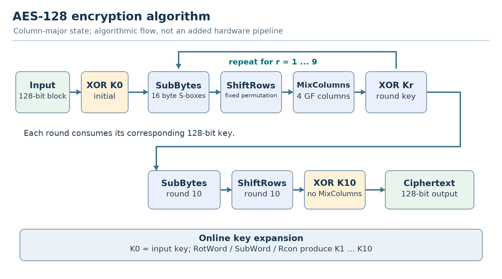
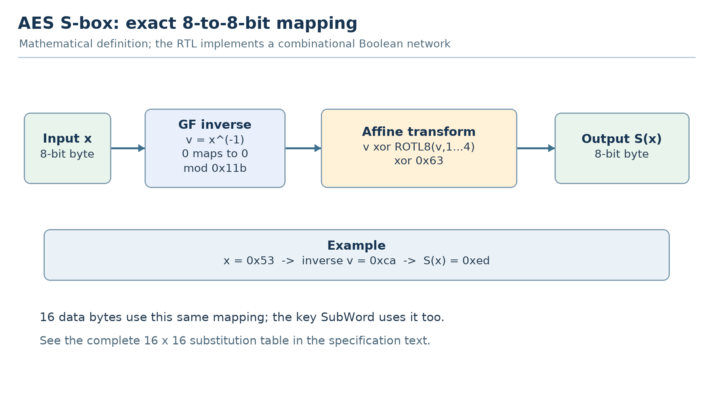
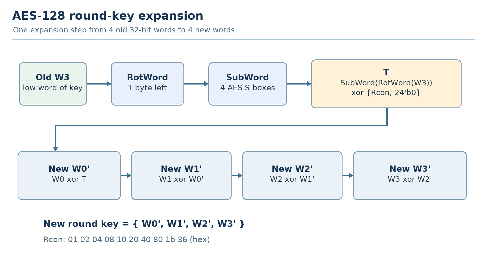
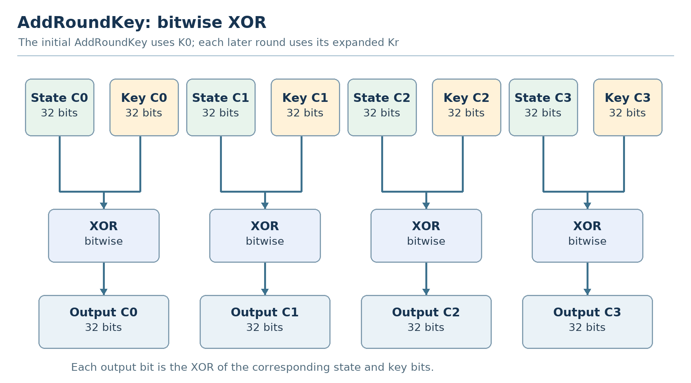
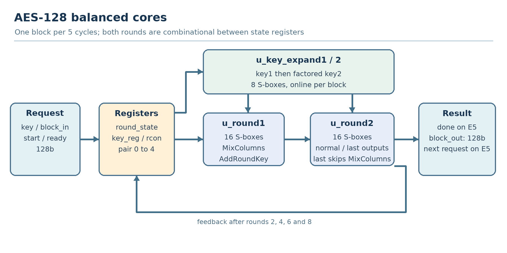
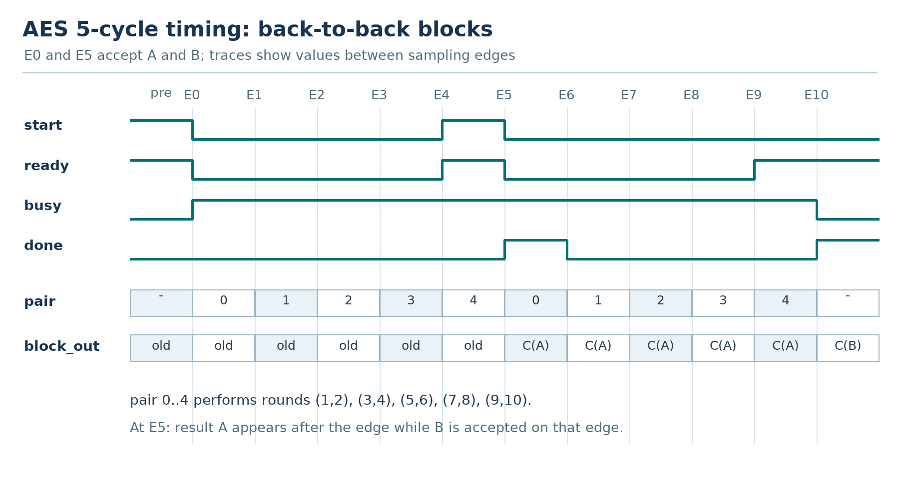

# 1 Introduction

## 1.1 Purpose

本文规定 MDM_SEC 的 **5 拍 balanced AES-128 块加密核**的 RTL 架构、接口、时序、验证和集成要求。原面积优化模块为 `mdm_aes128_balanced`，控制及寄存器位于 `rtl/mdm_aes128_balanced.v`，组合子模块位于 `rtl/mdm_aes_balanced_blocks.v`。新增完整性时序候选 `mdm_aes128_balanced_timing` 位于 `rtl/mdm_aes128_balanced_timing.v`；两者均为 5 拍。未特别标明候选的原网络说明及历史面积数字针对前者。

本文与同一 Git 提交中的 RTL 配套。5 拍是周期协议，不是目标工艺频率或面积签核；目标标准单元、约束、PVT 和布局布线结果未提供，物理 PPA 与安全认证均为 TBD。

## 1.2 Scope

本核完成 AES-128 的 128-bit 明文块加密和在线密钥扩展，接受的每一个块可以使用不同的 128-bit 密钥。它不提供 AES-192/256、AES 逆变换、总线寄存器、密钥管理、输出反压或认证结果。

`mdm_cipher` 使用此加密原语构造 EEA2/CTR，`mdm_integrity` 使用独立实例构造 EIA2/CMAC；CTR 明文和密文均与 AES 生成的密钥流异或，所以不需要逆变换。块原语的理论吞吐不等于整包吞吐。

## 1.3 Defines, Symbols, and Abbreviations

| 术语 | 定义 |
| --- | --- |
| AES-128 | 128-bit 密钥和分组、10 轮的 AES 加密。 |
| Block | 一次有效 `start && ready` 握手采样的 key 和输入数据。 |
| E0 / En | E0 为有效请求采样上升沿；En 是此后第 n 个上升沿。 |
| Latency | 从 E0 到 `done` 置位沿的周期数，结果在该沿寄存器更新后有效。 |
| II | Initiation Interval，两个被接受请求的最小间隔。 |
| S-box | AES 的 8-bit 非线性字节变换；本实现使用原工程 Boyar–Peralta 布尔电路。 |
| MixColumns | 对 4 字节列的固定 GF(2^8) 线性变换；第 10 轮省略。 |
| Rcon | AES-128 密钥扩展的轮常数。 |
| PPA / STA | 功耗、性能、面积 / 静态时序分析。 |
| Generic cell | Yosys 未映射到工艺库的通用逻辑单元；本报告将各种单元各计为 1。 |

## 1.4 Design Features

| 特性 | 实现 |
| --- | --- |
| RTL 模块 | `mdm_aes128_balanced` 和 `mdm_aes128_balanced_timing` 也可直接例化；接口与原 `mdm_aes128_fast` 一致。 |
| 系统选择 | `AES_LOW_AREA=2` 时 cipher 选择原 balanced，integrity 默认选择时序候选；`AES_INTEGRITY_TIMING_OPT=0` 回退。`0` 高速与 `1` 低面积保持不变，默认仍为 1。 |
| 块时序 | E0 接受，E1～E5 每拍处理连续两轮，E5 输出；延迟和最小 II 均为 5 周期。 |
| 连续请求 | 旧块最后计算沿可同时接收下一块；每块可更换 key，`busy` 与 `ready` 可同时为 1。 |
| 实现取舍 | 原版 MixColumns 使用 88-XOR 共享网络；完整性候选使用较浅的 XOR 网络、分离末轮输出并平坦化数据 S-box 内层。两版均使用代数化简的第二轮密钥扩展。 |
| 层次分析 | 两轮和密钥扩展拆成子模块；需在综合报告中确认层次未被 flatten/ungroup。 |
| 并行资源 | 每拍组合展开 32 个数据 S-box、8 个密钥扩展 S-box；不把两个 MDM_SEC 通道合并。 |
| 时钟和复位 | 统一上升沿时钟、异步低有效复位；复位释放同步由外部负责。 |
| 输出 | `done` 一拍脉冲；`block_out` 保存至下一次完成或复位，无输出反压。 |

## 1.5 References

| 编号 | 资料与用途 |
| --- | --- |
| R1 | NIST FIPS 197, Advanced Encryption Standard, updated 2023；https://doi.org/10.6028/NIST.FIPS.197-upd1 |
| R2 | NIST SP 800-38A / SP 800-38B：CTR 和 CMAC，均由外围通道实现。 |
| R3 | `rtl/mdm_aes128_balanced.v`, `rtl/mdm_aes128_balanced_timing.v`, `rtl/mdm_aes_balanced_blocks.v`, `rtl/mdm_aes_mix_balanced.vh`, `rtl/mdm_aes128_fast.v`, `rtl/mdm_aes128.v`。 |
| R4 | `rtl/mdm_aes_sbox.v` / `rtl/mdm_aes_sbox.vh`：AES S-box，BearSSL MIT 许可及版权原文保留在源码。 |
| R5 | Joe Bachir 的 AES MixColumns 88-XOR depth-5 电路，MIT；该电路源自 Jeremy Jean 的 88-XOR 工作（ePrint 2026/1481，Jean 首创）。来源及修改说明见 `rtl/mdm_aes_mix_balanced.vh`。 |
| R6 | `tests/rtl/tb_aes_random.sv`, `tests/rtl/tb_aes_balanced_blocks.sv`, `tests/formal/aes_mix_miter.v`, `docs/aes_balanced_hierarchy.md`, `docs/verification.md`。 |

# 2 Microarchitecture

## 2.1 Background (Algorithm Principle)

### 2.1.1 块加密与两轮展开



输入和输出都是 128 bit，`s[r,c]=block_in[127-8*(4*c+r) -: 8]`。先 `S0=block_in XOR K0`；第 1～9 轮依次做 SubBytes、ShiftRows、MixColumns、AddRoundKey，第 10 轮省略 MixColumns。`pair=0…4` 的每一拍分别组合执行两轮；算法图的方框不代表独立寄存器。

设列 `{a,b,c,d}`，GF(2^8) 模多项式为 `0x11b`；矩阵与 `mdm_aes128` 通用规格一致：

```text
[02 03 01 01]   [a]     [02*a XOR 03*b XOR c XOR d]
[01 02 03 01] x [b]  =  [a XOR 02*b XOR 03*c XOR d]
[01 01 02 03]   [c]     [a XOR b XOR 02*c XOR 03*d]
[03 01 01 02]   [d]     [03*a XOR b XOR c XOR 02*d]
```

`02*x=xtime(x)=((x<<1)&0xff) XOR (x[7] ? 0x1b : 0)`；`03*x=xtime(x) XOR x`。原 `aes_mix_column_balanced` 将该矩阵重写成 88 个两输入 XOR、最大逻辑深度 5 的共享网络；时序候选使用不同的浅层 XOR 实现。字节排列和数学输出一致，综合网表可以重排或复制这些节点。

### 2.1.2 S 盒与轮密钥的具体形式



S 盒的数学映射是 GF(2^8)/`0x11b` 乘法逆元（0 的逆约定为 0），再做 `v XOR ROTL8(v,1) XOR ROTL8(v,2) XOR ROTL8(v,3) XOR ROTL8(v,4) XOR 0x63`。例如 `S(0x53)=0xed`。RTL 使用组合布尔网络；图不是要求综合实现独立逆元单元。原版的数据 S 盒保留 top/nonlinear/bottom 层次；时序候选仅将**数据** S 盒内部合并，密钥扩展 S 盒仍保留原层次。

完整正向 S 盒见下表：行首表示输入的高四位，列表示低四位，十六进制字节为输出。例如 `50` 行第 `3` 列是 `ed`。

#### 2.1.2.1 AES S 盒完整表 (SBOX_AES)

```text
hi/lo  0  1  2  3  4  5  6  7  8  9  a  b  c  d  e  f
00     63 7c 77 7b f2 6b 6f c5 30 01 67 2b fe d7 ab 76
10     ca 82 c9 7d fa 59 47 f0 ad d4 a2 af 9c a4 72 c0
20     b7 fd 93 26 36 3f f7 cc 34 a5 e5 f1 71 d8 31 15
30     04 c7 23 c3 18 96 05 9a 07 12 80 e2 eb 27 b2 75
40     09 83 2c 1a 1b 6e 5a a0 52 3b d6 b3 29 e3 2f 84
50     53 d1 00 ed 20 fc b1 5b 6a cb be 39 4a 4c 58 cf
60     d0 ef aa fb 43 4d 33 85 45 f9 02 7f 50 3c 9f a8
70     51 a3 40 8f 92 9d 38 f5 bc b6 da 21 10 ff f3 d2
80     cd 0c 13 ec 5f 97 44 17 c4 a7 7e 3d 64 5d 19 73
90     60 81 4f dc 22 2a 90 88 46 ee b8 14 de 5e 0b db
a0     e0 32 3a 0a 49 06 24 5c c2 d3 ac 62 91 95 e4 79
b0     e7 c8 37 6d 8d d5 4e a9 6c 56 f4 ea 65 7a ae 08
c0     ba 78 25 2e 1c a6 b4 c6 e8 dd 74 1f 4b bd 8b 8a
d0     70 3e b5 66 48 03 f6 0e 61 35 57 b9 86 c1 1d 9e
e0     e1 f8 98 11 69 d9 8e 94 9b 1e 87 e9 ce 55 28 df
f0     8c a1 89 0d bf e6 42 68 41 99 2d 0f b0 54 bb 16
```



对旧密钥四个 32-bit 字 `w0…w3`，`t=SubWord(RotWord(w3)) XOR {Rcon,24'b0}`，然后 `w0'=w0 XOR t`、`w1'=w1 XOR w0'`、`w2'=w2 XOR w1'`、`w3'=w3 XOR w2'`；`K'={w0',w1',w2',w3'}`。Rcon 依次为 `01 02 04 08 10 20 40 80 1b 36`。每个周期两级密钥扩展产生对应两轮的 `key1/key2`，第二级采用 2.2.5 的等价化简公式。



AddRoundKey 是状态和相应 128-bit 轮密钥的逐位 XOR：输入先与 K0 异或，普通轮用 K1～K9，末轮用 K10。FIPS 示例 key `000102030405060708090a0b0c0d0e0f` 的 K1 为 `d6aa74fdd2af72fadaa678f1d6ab76fe`；`00112233445566778899aabbccddeeff XOR K0 = 00102030405060708090a0b0c0d0e0f0`。

## 2.2 Microarchitecture Analysis

### 2.2.1 Top Level Diagram



图中两个轮函数和两次密钥扩展在一个时钟周期内组合串接；图中间的两个轮不是两个寄存器流水级。图为逻辑示意，时序候选将普通反馈和末轮结果分开。每个包装器一次只实例化串行版、原高速版或两个 balanced 版本之一。

| 部分 | 职责 |
| --- | --- |
| 请求及初始 AddRoundKey | `start && ready` 沿采样 key 和 block，写入 `round_state=block_in XOR key`。 |
| `key1/key2` | 根据当前 `key_reg` 和 `rcon` 在线扩展两个轮密钥，下一对轮继续使用 `key2`。 |
| `round1/round2` | 每拍完成连续两轮；`pair=4` 时第二轮为第 10 轮，旁路 MixColumns。 |
| `pair` / 控制 | 计数 0～4；末拍置 `done` 和结果，同时可装载下一块。 |
| 两个通道 | `mdm_sec` 的 cipher、integrity 各有自己的包装器、密钥和 AES 状态。 |

### 2.2.2 Timing Requirement



波形中的竖线为采样沿；`start` 在 E0/E5 沿前有效，`done`、`block_out` 和 `pair` 为沿后值。E5 既输出前块 A 又接收后块 B，两个沿之间 `busy` 不必拉低；该图适用于两个 balanced 实现和原高速版。

| 时刻 | 行为 |
| --- | --- |
| E0 | 在 `rst_n=1 && start && ready` 时采样 key/block，初始 AddRoundKey，开始处理。 |
| E1 | 完成第 1、2 轮，保存新的轮状态与轮密钥。 |
| E2 | 完成第 3、4 轮。 |
| E3 | 完成第 5、6 轮。 |
| E4 | 完成第 7、8 轮；沿后进入 `pair=4`，`busy=1` 且 `ready=1`，在 E5 沿前可提交下一块。 |
| E5 | 完成第 9、10 轮，沿后 `done=1` 且 `block_out` 为旧块结果；本沿也可接受新的 key/block。 |
| E6～E10 | 如果 E5 接收新块，在 E10 输出新块，可继续每 5 拍交接。 |

不要求前后块使用同一密钥，也没有密钥预计算或额外密钥装载周期。连续块理论吞吐上限为 `128 × f_clk / 5` bit/s；例如 100 MHz 时为 2.56 Gbit/s，但实际工作频率必须由目标工艺、约束和 STA 确认。CTR 缓冲、CMAC 链依赖和包调度可能降低系统吞吐。

| 时序项 | 状态 |
| --- | --- |
| 目标时钟与 I/O 约束 | TBD，由 SoC 集成提供 SDC。 |
| 两轮组合关键路径、fanout、WNS/TNS | TBD，由目标库映射与布局布线后 STA 确认。 |
| 同频吞吐要求 | 优化版必须在原目标时钟下收敛；仅保持 5 周期不证明实际比特率不下降。 |
| 复位释放 recovery/removal | TBD，外部提供满足本时钟域约束的同步释放。 |

### 2.2.3 Peripheral Interface

模块是块级握手原语，没有 APB/AXI 接口。上游只在 `rst_n=1` 且 `start && ready` 的上升沿提交；其他忙周期的 `start` 不被接受。允许 E5 旧块退休和新块请求同沿发生，新 key/block 必须在该沿满足建立保持要求。

`ready` 不直接与 `rst_n` 相与，复位空闲状态下可能为 1；系统在复位期间不能提交有效请求。下游在 `done` 为 1 时采样 `block_out`，没有结果反压，停顿时需在外围添加缓冲。

### 2.2.4 Sub-modules

| 实例 / 逻辑 | 实现和职责 |
| --- | --- |
| `u_initial_add_round_key` | 输入块与初始密钥的 128-bit XOR。 |
| `u_key_expand1/2` | 两个轮密钥扩展模块；各含 4 个 S-box，第二轮使用代数消去后的 XOR 方程。 |
| `u_round1/2` | 两个组合轮模块，各含 `u_subbytes`、`u_shift_rows`、`u_mix_columns`、`u_add_round_key`。 |
| `u_subbytes.g_byte[0..15].u_sbox` | 每轮 16 个分层的 BearSSL Boyar–Peralta S-box；各含 `u_top/u_nonlinear/u_bottom`。 |
| `u_mix_columns.g_column[0..3].u_mix_column` | 每轮 4 个 32-bit、88 XOR 的共享线性网络；第二轮在第 10 轮旁路。 |
| `state/next_state` | `IDLE` / `COMPUTE` 两状态；寄存器、次态和输出/数据路径分区。 |

模块划分参考仓库 Python AES 的 `key_expansion`、`sub_bytes`、`shift_rows`、`mix_columns` 和 `add_round_key`；没有增加寄存器。层次报告需检查工具是否 flatten/ungroup；父级若包含子级，不能重复累加面积。

完整性时序候选保留轮、SubBytes、ShiftRows、MixColumns 和 AddRoundKey 层次，但数据 S-box 内部三层合并以允许跨层综合；密钥扩展的 S-box 保持原层次。候选的列混合采用深度导向 XOR 结构，普通反馈和末轮输出使用不同的 AddRoundKey，普通反馈不经过末轮选择 mux。该变更可能增加面积，且不能保证目标库实际时序改善。

### 2.2.5 Pipeline Design

本核是两轮展开的单块迭代结构，不是每周期能接收新块的 10 级深流水。`round_state/key_reg` 在 E1～E4 保存结果；E5 写 `block_out`。同沿新请求具有对状态/key 寄存器的装载优先级，旧结果仍由沿前的轮组合逻辑产生并写入独立输出寄存器。

设旧密钥 32-bit 字为 `A,B,C,D`，第一轮密钥为 `A1,B1,C1,D1`，令 `T2=SubWord(RotWord(D1)) XOR {Rcon2,24'b0}`。基于第一轮扩展的 XOR 关系，第二轮直接得到：

```text
A2 = A1 XOR T2       B2 = B XOR T2
C2 = C  XOR A2       D2 = D XOR B2
```

这与两次标准 `next_key` 等价，且减少部分串联 XOR 依赖；不缓存其他块的密钥，也不改变采样时序。

### 2.2.6 Resource Consumption

| 项目 | RTL 结构统计，非物理面积 |
| --- | --- |
| 状态寄存器 | `round_state` 128 bit、`key_reg` 128 bit、`block_out` 128 bit。 |
| 控制寄存器 | `rcon` 8 bit、`pair` 3 bit、`state` 1 bit、`done` 1 bit；时序声明合计 397 bit。 |
| S-box | 32 个数据路径 + 8 个轮密钥扩展的组合实例，物理映射由综合工具决定。 |
| MixColumns | 每组合轮 4 列，共 8 份 32-bit 线性网络；最后轮选择旁路。 |
| 外部存储 | 无 RAM/SRAM；无密钥扩展预计算表。 |

### 2.2.7 Synthesis Analysis

同条件单核对比：Yosys 0.64（YoWASP），`synth -noabc; check -assert; stat; flatten; ltp -noff`，无目标库或时钟约束。原高速核为 `AES_LOW_AREA=0`，优化核为 `2`。

| 指标 | 原 5 拍高速核 | 5 拍优化核 | 变化 |
| --- | --- | --- | --- |
| 未映射通用单元总数 | 7,321 | 6,937 | −384，约 −5.25% |
| 通用 XOR 单元数 | 5,072 | 4,688 | −384 |
| 不计触发器的最长拓扑路径（未加权层数） | 70 | 68 | −2 层，不代表实际时序 |
| 逻辑周期延迟 / 最小 II | 5 / 5 | 5 / 5 | 不变 |

每类通用单元均按 1 个计数，拓扑路径的各单元同样不带延时权重；结果不是标准单元面积、门等效数、功耗或 STA。综合器和工艺库可能重排该网络；减小通用单元数或拓扑层数不保证真实面积下降或频率不变。运行 `make area-aes-balanced` 可复现同口径报告。

另以 Yosys 0.71 比较原 balanced 和完整性时序候选：通用单元 6,937 / 7,097；`round_state[99]` 到 `[2]` 的单位权重拓扑为 65 / 61 级，任意状态反馈最深 68 / 66 级。方法和限制见 `make area-aes-timing` 与 `docs/aes_balanced_hierarchy.md`；这不表示节省了某个 ps 数值或 375 MHz 已收敛。

| 物理签核项 | 状态 |
| --- | --- |
| 工艺、库、PVT、时钟和 I/O SDC | TBD |
| 面积、利用率、缓冲/布线开销 | TBD |
| WNS/TNS、频率、关键路径及负载 | TBD |
| DFT/scan、门级仿真与安全认证 | TBD |

### 2.2.8 Power Analysis

本核未专门实例化时钟门控、密钥零化、隔离或功耗状态控制。空闲时寄存器保持，但组合逻辑和时钟树并非零功耗。应以目标网表及代表性 SAIF/VCD/FSDB 活动，评估动态、静态和峰值功耗；目前均为 TBD。

### 2.2.9 Debug and Trace

建议观察 `state`、`pair`、`rcon`、`round_state`、`key_reg`、`key1/key2`、`round1` 及 `start/ready/busy/done/block_out`。原版包装器路径为 `g_balanced.u_core`，时序候选为 `g_balanced_timing.u_core`；后者分别使用 `round2_normal/round2_last`。工具可能增加 generate 层次；在 E0、E5 和连续块交接边界检查时序。

波形可能泄漏 key、明文和中间轮状态，不应在生产或公开文件中记录真实密钥。综合 flatten 或优化会改变内部节点名称；真实 VCS/Verdi PLI 及原生 FSDB 需要在用户授权环境验证。

### 2.2.10 Verification and Acceptance

| 项目 | 证据及限制 |
| --- | --- |
| 固定答案 | FIPS-197 key `000102030405060708090a0b0c0d0e0f`，input `00112233445566778899aabbccddeeff`，output `69c4e0d86a7b0430d8cdb78070b4c55a`。 |
| AES 回归 | `make test-aes`：新核 515 块，覆盖每块变换 key、5 拍延迟/最早连续启动、忙时无效请求、输入变化及复位中止；向量独立交叉检查 PyCryptodome。 |
| 模块与层次 | `make test-aes-balanced-blocks` 对比 518 个 Python 中间状态向量；`make test-aes-hierarchy` 检查综合后可报告的模块及顶层两路独立实例。 |
| 数学等价 | `make test-aes-formal`：两种 MixColumns 和两种 S-box 的全输入 SAT 对比；原高速、原 balanced 与时序候选分别使用 Yosys `equiv_simple` 对比。异步复位采用 `async2sync`，假设异步信号对时钟同步、异步触发器输入为负保持时间；并非任意复位释放波形的无条件证明。 |
| 双通道系统 | `make test-balanced`：原语、两条通道、2641 个 2048 字节容量包和 12 个最大容量边界包；`make test-balanced-fallback` 对回退配置重复包级回归。 |
| 四态冒烟 | 转网包内 RTL 和 testbench 经 Icarus WebAssembly，时序候选及回退配置各通过 20 个定向包和 8 个 AES 块；FSDB 宏仅做 HDL 编译，未执行 PLI。 |
| 待办 | 目标库综合、同频 STA、DFT、门级、真实 VCS/PLI 和侧信道评估仍待完成。 |

# 3 I/O Interface

## 3.1 Parameters and Selection

`mdm_aes128_balanced` 本身无参数；以下为包装器及顶层使用的静态参数。历史名称 `AES_LOW_AREA` 已扩展为三值选择，不能在运行时逐块更改。

| 参数 | 默认值 | 说明 |
| --- | --- | --- |
| `AES_LOW_AREA` | 1 | 0：原高速 5/5 拍；1：低面积 50/50 拍；2：balanced 5/5 拍；其他值非法。 |
| `AES_INTEGRITY_TIMING_OPT` | 1 | `mdm_sec` 顶层参数；`AES_LOW_AREA=2` 时 1 让完整性选时序候选，0 选原 balanced；cipher 不变。 |
| `BALANCED_TIMING_OPT` | 0 | `mdm_aes128` 包装器参数，仅 `AES_LOW_AREA=2` 有效；`mdm_integrity` 默认传 1。 |

```verilog
mdm_sec #(.MAX_BYTES(2048), .AES_LOW_AREA(2)) u_sec (...);
// 或直接例化 mdm_aes128_balanced，端口与原高速核相同。
```

## 3.2 Port Definition

| 信号 | 方向 | 位宽 | 描述 |
| --- | --- | --- | --- |
| `clk` | 输入 | 1 | 主时钟，上升沿采样和更新。 |
| `rst_n` | 输入 | 1 | 异步低有效复位；释放由外部同步并满足时序。 |
| `start` | 输入 | 1 | 请求；仅 `rst_n=1 && start && ready` 的上升沿被接受。 |
| `ready` | 输出 | 1 | 空闲及旧块最后计算周期可接受新块；复位期不可据此提交。 |
| `key` | 输入 | 128 | 有效接受沿采样的 AES-128 key，高字节在高位。 |
| `block_in` | 输入 | 128 | 有效接受沿采样的明文块，高字节在高位。 |
| `busy` | 输出 | 1 | 正在计算旧块；最后周期可与 `ready` 同时为 1。 |
| `done` | 输出 | 1 | 结果完成脉冲；E5 寄存器更新后有效。 |
| `block_out` | 输出 | 128 | 加密结果；保持至下一次完成或复位。 |

## 3.3 Protocol, Reset and Corner Cases

- 上游以 `ready` 判断是否接受，不可仅用 `busy` 推断；`start` 一直为 1 时，E5 会再次接受当时的输入。
- 被接受沿之后可改变 key/block；不允许因 `start=1, ready=0` 误计为已接受块。
- 异步复位中止当前块并清控制、状态、密钥寄存器及输出；释放后从空闲重新开始，被中止块由系统重发。
- `done` 不支持下游反压；如系统不能及时捕获结果，必须自行添加缓冲。
- 本核不是安全认证实现，既不掩码 S-box 也不防故障注入；系统必须定义密钥保护、零化和波形访问策略。

# 4 Open Issue

| 编号 | 未决事项 / 风险 | 状态与建议负责人 |
| --- | --- | --- |
| AES-BAL-OI-01 | 目标工艺、库、时钟、面积和同频 STA 未签核。 | Open；综合/STA 团队。 |
| AES-BAL-OI-02 | 异步复位释放同步、CDC、scan 及目标门级行为待确认。 | Open；SoC/DFT 团队。 |
| AES-BAL-OI-03 | 无输出反压；外围必须保证结果接收或缓冲。 | Open；系统集成团队。 |
| AES-BAL-OI-04 | 无专用零化、侧信道掩码或故障检测，调试可能泄漏秘密。 | Open；安全团队。 |
| AES-BAL-OI-05 | 真实 VCS/Verdi、PLI、FSDB 和目标工艺测试未在本环境完成。 | Open；验证团队。 |
