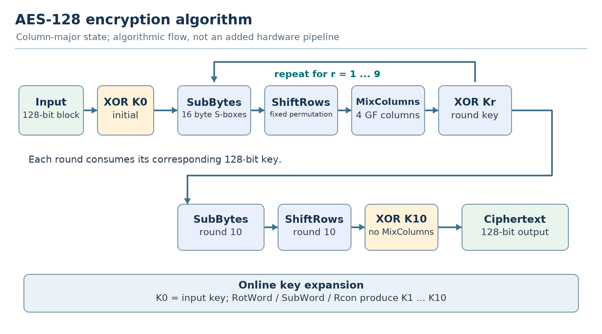
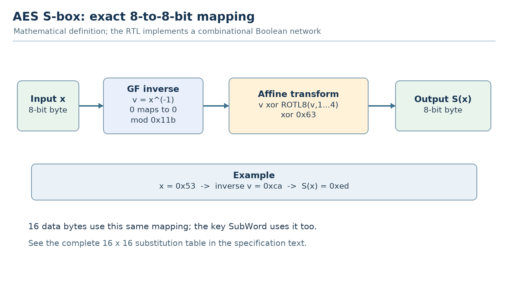
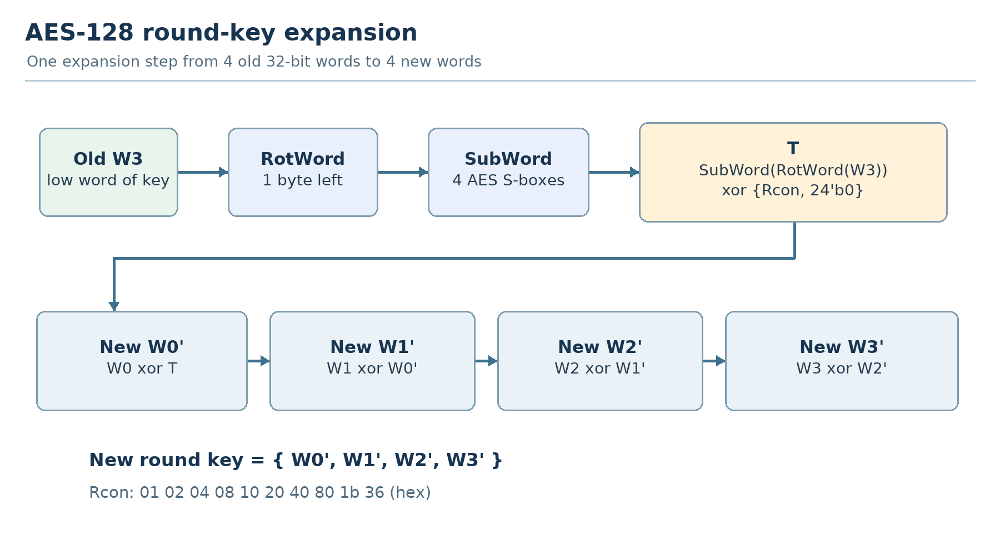
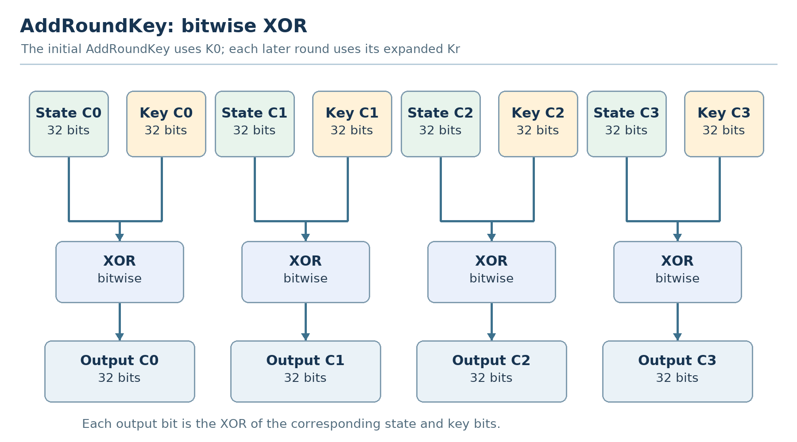
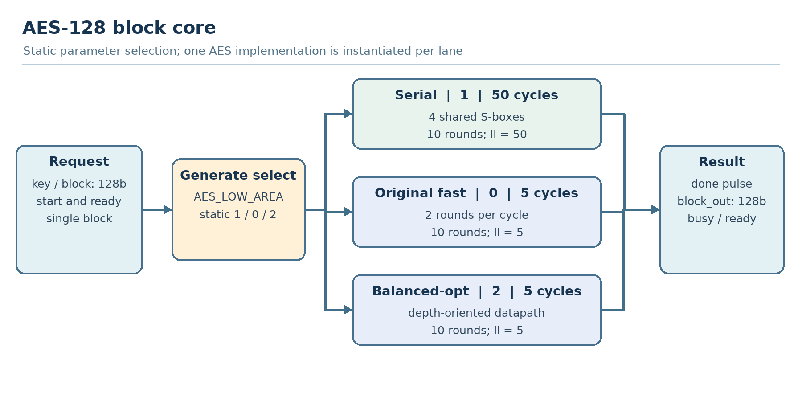
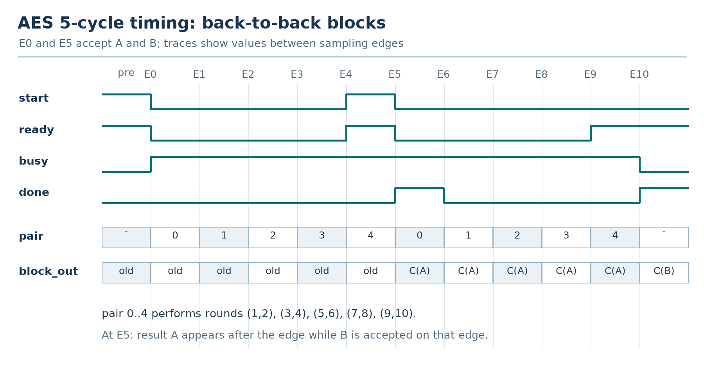
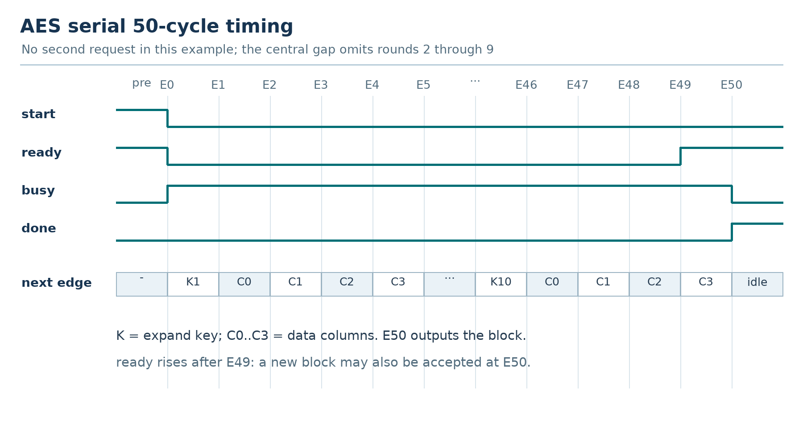

# 1 Introduction

## 1.1 Purpose

本文规定 MDM_SEC 工程中 AES-128 块加密原语的 RTL 行为、接口、微架构和集成约束，供 RTL 设计、验证、综合、时序及系统集成人员评审。用户所称 **aes_core** 在当前 RTL 中对应顶层包装模块 `mdm_aes128`，并由参数选择 `mdm_aes128_serial`、`mdm_aes128_fast` 或 `mdm_aes128_balanced_timing`；仓库中不存在名为 `aes_core` 的独立 Verilog module。

本说明描述 RTL 现状而非工艺签核承诺。除明确标注为已完成的通用综合或功能仿真以外，频率、标准单元面积、功耗和安全认证均为待定。若本文与基线 RTL 不一致，应提交问题并以受控版本的 RTL 和协议评审结论为准。

## 1.2 Scope

本规范覆盖 `mdm_aes128` 的参数、块级接口、复位、请求与结果时序，以及低面积、原高速和 5 拍 balanced-opt 三种可选实现。算法仅包含 128-bit key、128-bit block 的 **AES 加密变换**；AES-192、AES-256、AES 逆变换、密钥管理、DMA 和总线寄存器不在此核范围内。

CTR 模式加解密和 CMAC 完整性属于外围 `mdm_cipher` / `mdm_integrity` 的组合方式，不是本原语额外的端口功能。在 CTR 中，明文和密文均与由 AES 加密计数器得到的密钥流异或，因此不需要 AES 逆变换。

## 1.3 Defines, Symbols, and Abbreviations

| 术语 | 定义 |
| --- | --- |
| AES-128 | 128-bit 密钥、128-bit 数据块、10 轮的 AES 加密。 |
| Block | 一次由 `start && ready` 接受的 128-bit 输入及其密钥。 |
| E0 / En | E0 为请求被采样的上升沿；En 是此后第 n 个上升沿。输出在对应沿的寄存器更新后有效。 |
| Latency | 从 E0 到 `done` 置位所在时钟沿的周期数，不含外部准备与等待。 |
| II | Initiation Interval，两次被接受请求的最小上升沿间隔。 |
| S-box | AES 字节非线性替换；低面积实现以 4 个 S-box 时间复用。 |
| SubBytes / ShiftRows | 字节非线性替换 / 按行进行固定字节置换。 |
| MixColumns | 在 GF(2^8) 上对每个 32-bit 列进行线性变换，最后一轮省略。 |
| AddRoundKey | 轮状态与对应轮密钥按位异或。 |
| Rcon | AES 轮密钥扩展所用的轮常数。 |
| CTR / CMAC | 分组密码计数器模式 / 基于分组密码的消息认证码，均由外围通道实现。 |
| PPA / STA | 功耗、性能、面积 / 静态时序分析。 |

## 1.4 Design Features

| 特性 | 当前设计 |
| --- | --- |
| 顶层与实现 | `mdm_aes128`；`AES_LOW_AREA=1` 选择串行版，`0` 选择原高速版，`2` 选择 5 拍 balanced-opt，选择在 elaboration 时完成。 |
| 数据与密钥 | `key`、`block_in`、`block_out` 均 128 bit，高字节先表示标准十六进制字节序。 |
| 算法 | AES-128 加密，10 轮；每次请求可使用不同密钥和输入。 |
| 低面积配置 | 每轮 1 拍密钥扩展 + 4 拍数据列处理；50 周期延迟，最小 II 为 50 周期。 |
| 5 拍配置 | 原高速版及 balanced-opt 均组合展开每拍 2 轮；5 周期延迟，最小 II 为 5 周期。 |
| 块衔接 | 前一块的最后一个计算沿允许 `start && ready` 接受下一块；`busy` 与 `ready` 可以同时为 1。 |
| 时钟/复位 | 单一 `clk` 上升沿；`rst_n` 异步低有效。复位释放同步由外部负责。 |
| 结果 | `done` 为完成脉冲，无结果反压信号；`block_out` 寄存保持至下次完成或复位。 |

## 1.5 References

| 编号 | 资料与用途 |
| --- | --- |
| R1 | NIST FIPS 197, Advanced Encryption Standard, updated 2023，算法和 AES-128 示例；https://doi.org/10.6028/NIST.FIPS.197-upd1 |
| R2 | NIST SP 800-38A, Recommendation for Block Cipher Modes of Operation: Methods and Techniques，CTR 模式背景。 |
| R3 | NIST SP 800-38B, Recommendation for Block Cipher Modes of Operation: the CMAC Mode for Authentication，CMAC 背景。 |
| R4 | `rtl/mdm_aes128.v`, `rtl/mdm_aes128_serial.v`, `rtl/mdm_aes128_fast.v`, `rtl/mdm_aes128_balanced_timing.v`，本规范 RTL 基线。 |
| R5 | `rtl/mdm_aes_blocks.v`, `rtl/mdm_aes_balanced_blocks.v`, `rtl/mdm_aes_sbox.v`, `rtl/mdm_aes_sbox.vh`，数据路径及 S-box 实现；S-box 许可见源码。 |
| R6 | `tests/rtl/tb_aes_random.sv`, `tests/rtl/tb_primitives.sv`, `docs/verification.md`, `docs/area_optimization.md`。 |

# 2 Microarchitecture

## 2.1 Background (Algorithm Principle)

### 2.1.1 AES-128 加密流程



输入为明文 `P` 和 128-bit key `K0`。先执行 `S0=P XOR K0`；第 1～9 轮执行 `Sr=AddRoundKey(MixColumns(ShiftRows(SubBytes(Sr-1))),Kr)`；第 10 轮执行 `C=AddRoundKey(ShiftRows(SubBytes(S9)),K10)`，**不执行 MixColumns**。图为数学步骤；串行核和 5 拍核的实际复用、寄存器位置见后续微架构和时序图，不表示图中的每个方框都是一级流水。

### 2.1.2 状态矩阵和轮内线性变换

将输入 16 字节从高位到低位编号 0～15。状态按列填充，`s[r,c]=block_in[127-8*(4*c+r) -: 8]`；例如第 0 列为输入字节 0、1、2、3。SubBytes 对每个字节独立应用同一 S 盒；ShiftRows 第 r 行循环左移 r 个字节，即输出 `s'[r,c]=s[r,(c+r) mod 4]`。

MixColumns 对每个 4 字节列 `{a,b,c,d}` 乘以下列固定矩阵；所有加法为 XOR，乘法在模 `x^8+x^4+x^3+x+1`（`0x11b`）的 GF(2^8) 中计算。`02*x=xtime(x)=((x<<1)&0xff) XOR (x[7] ? 0x1b : 0)`，`03*x=xtime(x) XOR x`。

```text
[02 03 01 01]   [a]     [02*a XOR 03*b XOR c XOR d]
[01 02 03 01] x [b]  =  [a XOR 02*b XOR 03*c XOR d]
[01 01 02 03]   [c]     [a XOR b XOR 02*c XOR 03*d]
[03 01 01 02]   [d]     [03*a XOR b XOR c XOR 02*d]
```

低面积 RTL 先以连线完成 ShiftRows 再对选中的 4 字节应用 SubBytes；由于替换对各字节相同且相互独立，两操作可交换而不改变标准结果。balanced-opt 使用浅层 XOR 列网络，与上述矩阵等价。

### 2.1.3 AES S 盒的具体形式



对输入字节 `x`，先在 GF(2^8)/`0x11b` 中求乘法逆元 `v`，约定 `x=0` 时 `v=0`；随后 `S(x)=v XOR ROTL8(v,1) XOR ROTL8(v,2) XOR ROTL8(v,3) XOR ROTL8(v,4) XOR 0x63`。例如 `S(0x53)=0xed`，`S(0x00)=0x63`。该逆元加仿射变换是**数学定义**；本 RTL 的 S 盒为组合布尔网络，并非必然例化逆元运算器或 ROM。

下表列出正向 AES S 盒全部 256 个输出。行首为输入高四位加 0，表头为低四位；例如行 `50`、列 `3` 为输入 `0x53`。字节值均为十六进制。表也用于密钥扩展中的 SubWord。

#### 2.1.3.1 AES S 盒完整表 (SBOX_AES)

```text
hi/lo  0  1  2  3  4  5  6  7  8  9  a  b  c  d  e  f
00     63 7c 77 7b f2 6b 6f c5 30 01 67 2b fe d7 ab 76
10     ca 82 c9 7d fa 59 47 f0 ad d4 a2 af 9c a4 72 c0
20     b7 fd 93 26 36 3f f7 cc 34 a5 e5 f1 71 d8 31 15
30     04 c7 23 c3 18 96 05 9a 07 12 80 e2 eb 27 b2 75
40     09 83 2c 1a 1b 6e 5a a0 52 3b d6 b3 29 e3 2f 84
50     53 d1 00 ed 20 fc b1 5b 6a cb be 39 4a 4c 58 cf
60     d0 ef aa fb 43 4d 33 85 45 f9 02 7f 50 3c 9f a8
70     51 a3 40 8f 92 9d 38 f5 bc b6 da 21 10 ff f3 d2
80     cd 0c 13 ec 5f 97 44 17 c4 a7 7e 3d 64 5d 19 73
90     60 81 4f dc 22 2a 90 88 46 ee b8 14 de 5e 0b db
a0     e0 32 3a 0a 49 06 24 5c c2 d3 ac 62 91 95 e4 79
b0     e7 c8 37 6d 8d d5 4e a9 6c 56 f4 ea 65 7a ae 08
c0     ba 78 25 2e 1c a6 b4 c6 e8 dd 74 1f 4b bd 8b 8a
d0     70 3e b5 66 48 03 f6 0e 61 35 57 b9 86 c1 1d 9e
e0     e1 f8 98 11 69 d9 8e 94 9b 1e 87 e9 ce 55 28 df
f0     8c a1 89 0d bf e6 42 68 41 99 2d 0f b0 54 bb 16
```

### 2.1.4 轮密钥生成与轮密钥加



把当前 key 高位到低位分成 32-bit 的 `w0,w1,w2,w3`，对第 r 轮先将 `w3` 高字节旋转到最低字节，再对四个字节分别查 AES S 盒，并在最高字节异或本轮常数：

```text
t   = SubWord(RotWord(w3)) XOR {Rcon[r], 24'b0}
w0' = w0 XOR t       w1' = w1 XOR w0'
w2' = w2 XOR w1'     w3' = w3 XOR w2'
Kr  = {w0', w1', w2', w3'}
Rcon[1..10] = 01 02 04 08 10 20 40 80 1b 36
```



轮密钥加只是 128 对对应位的 XOR，不包含 S 盒或模加：初始步骤使用 `K0`，普通轮使用 `K1…K9`，末轮使用 `K10`。例如 FIPS 示例 key `000102030405060708090a0b0c0d0e0f` 的 `K1=d6aa74fdd2af72fadaa678f1d6ab76fe`；输入 `00112233445566778899aabbccddeeff` 经初始轮密钥加后为 `00102030405060708090a0b0c0d0e0f0`。轮密钥按块在线计算，不通过本核端口输出。

## 2.2 Microarchitecture Analysis

### 2.2.1 Top Level Diagram



图中参数选择为静态 generate，不是按块可变的运行时模式。各实现的端口及标准答案一致，但低面积版与 5 拍版的延迟和连续请求边界不同。`AES_LOW_AREA=2` 固定选择 balanced-opt；旧 balanced 已移除，不存在运行时备份。

| RTL 层次 | 作用 |
| --- | --- |
| `mdm_aes128` | 对 `AES_LOW_AREA` 做合法性检查，并选择一个实现实例。 |
| `g_low_area.u_core` | `mdm_aes128_serial`，四个 S-box、列复用及 50 周期控制。 |
| `g_fast.u_core` | `mdm_aes128_fast`，每周期两个 AES 轮的原高速组合数据路径。 |
| `g_balanced_timing.u_core` | `mdm_aes128_balanced_timing`，唯一的 5 拍 balanced-opt；目标时序需现场 STA。 |
| `mdm_cipher.u_aes` / `mdm_integrity.u_aes` | MDM_SEC 的两个独立 AES 实例；不在两个通道之间共享一个块核。 |

### 2.2.2 Timing Requirement

下表从请求实际被采样的 E0 计数；`done` 和 `block_out` 是对应上升沿之后寄存器更新的值。`ready` 在最后计算沿之前为 1，因而 E50/E5 可同时退休旧块并接受新块。波形中的竖线是采样沿，信号值画在两沿之间；`pair`/结果为沿后值。第一个图在 E5 同沿完成 A、接收 B；第二个图中间省略第 2～9 轮，仅示单块。





| 配置 | 接受 | 运算沿 | 完成和最早下次接受 | 延迟 / II |
| --- | --- | --- | --- | --- |
| `AES_LOW_AREA=1` | E0：`start && ready` | E1～E50：10×(1 密钥 + 4 列) | E50：旧结果 `done=1`；可接受下一块 | 50 / 50 周期 |
| `AES_LOW_AREA=0` | E0：`start && ready` | E1～E5：每拍 2 轮 | E5：旧结果 `done=1`；可接受下一块 | 5 / 5 周期 |
| `AES_LOW_AREA=2` | E0：`start && ready` | E1～E5：每拍 2 轮 | E5：旧结果 `done=1`；可接受下一块 | 5 / 5 周期 |

`ready` 只在空闲及最后计算周期为 1。忙时不具备 ready 的 `start` 不被接受；若 `start` 一直保持高电平，最后沿可能再次接受当时的输入，这是电平握手而非上升沿触发。外围须在有效请求被采样时提供并保持稳定的 key/block，且按需要撤销 `start`。

在无间断请求时，原语理论上限为 `128 × f_clk / 50` bit/s 或 `128 × f_clk / 5` bit/s。此处 `f_clk` 是待签核的实际工作频率，公式不包含外围等待、CTR 字流供给、CMAC 链依赖或系统接口带宽，不代表工艺频率保证。

| 物理时序项 | 数值 / 状态 |
| --- | --- |
| 目标时钟周期、频率 | TBD：由目标 SoC 和 SDC 约束提供。 |
| 输入/输出延迟、时钟不确定度 | TBD：由集成约束和时钟树提供。 |
| 复位释放 recovery/removal | TBD：外部应实现满足时钟域要求的同步释放。 |
| 关键路径与时序裕量 | TBD：需目标工艺综合和 STA；高速两轮组合路径及低面积 S-box 路径应重点检查。 |

### 2.2.3 Peripheral Interface

本模块是同步块原语，不含 APB/AXI/寄存器配置接口。上游在 `rst_n=1` 且 `start && ready` 的上升沿提交 `key` 与 `block_in`；该沿之后可以改变这两个输入。下游必须在 `done` 脉冲期间捕获 `block_out`，接口没有 `out_ready`、响应 FIFO 或错误返回。

`ready` 的组合表达式未直接与 `rst_n` 相与：复位把状态置为空闲后 `ready` 可以显示为 1，但复位期间不能构成有效请求。复位会中止进行中的块并清除控制、数据寄存器；中止的块不会自动重试。

### 2.2.4 Sub-modules

| 子模块 / 逻辑 | 低面积版功能 |
| --- | --- |
| `u_shift_rows` / `mdm_aes_shift_rows` | 固定字节连线，输出重排行状态。 |
| `u_subbytes` / `mdm_aes_subbytes4` | 4 个 `mdm_aes_sbox`；密钥扩展与数据列在不同时钟复用。 |
| `u_key_expand` / `mdm_aes_key_expand` | 根据共享 S-box 结果、Rcon、旧轮密钥生成下一轮密钥。 |
| `u_mix_column` / `mdm_aes_mix_column` | 对一个 32-bit 列进行 MixColumns；最后一轮旁路。 |
| `u_add_round_key` | 一个 32-bit 列与对应轮密钥列异或。 |
| `u_sbox.u_top/u_nonlinear/u_bottom` | S-box 分层的线性/非线性布尔电路；版权与许可保留在源文件。 |
| 原高速版 `next_key`、`round_fn` | Verilog function 形成两级组合轮和密钥扩展。 |
| 优化版 `u_key_expand1/2`、`u_round1/2` | 可例化模块分别实现密钥扩展和两轮数据路径；每轮含 SubBytes、ShiftRows、MixColumns、AddRoundKey 子模块。 |

### 2.2.5 Pipeline Design

低面积控制状态为 `IDLE`、`ROUND_KEY`、`ROUND_DATA`。E0 保存 `round_state=block_in XOR key` 和初始密钥；每轮 `ROUND_KEY` 更新轮密钥，然后 `ROUND_DATA` 依次处理列 0～3。前 3 列暂存于 `partial_state[95:0]`，第 4 列与暂存结果组合形成下一轮状态；第 10 轮的第 4 列产生输出。

两个 5 拍实现状态均为 `IDLE` / `COMPUTE`，组合逻辑形成 `key1/key2` 和两轮结果，`pair=0..4` 顺次执行。最后一次的第二轮跳过 MixColumns；balanced-opt 的普通反馈和最后轮输出分离。三种实现都是单块迭代复用结构而不是每拍接受一个独立块的深流水；末沿交接不表示可同时处理任意数量在途块。

### 2.2.6 Resource Consumption

以下为 RTL 声明层面的结构统计，不等于目标门数或物理面积。`next_state` 是组合量，不计入寄存器清单；综合常量传播及实现会改变最终触发器数量。

| 项目 | 低面积 | 原高速 / 5 拍优化 |
| --- | --- | --- |
| 核心状态和控制寄存器 | 按源码声明约 497 bit，含块输出和 `done` | 按源码声明约 397 bit，含块输出和 `done` |
| S-box 结构 | 4 个组合 S-box，共享密钥与数据 | 原高速版为组合 function；balanced-opt 例化 32 个数据和 8 个密钥 S-box，数据 S-box 内部合并为一层；实际映射待综合。 |
| MixColumns | 1 个 32-bit 列单元，四列复用 | 每拍组合两轮，最后轮旁路；balanced-opt 使用浅层 XOR 网络。 |
| 外部 RAM / SRAM | 无 | 无 |
| MDM_SEC 实例数量 | cipher、integrity 各 1 个 | cipher、integrity 各 1 个 |

### 2.2.7 Synthesis Analysis

同条件 Yosys 0.71、`synth -noabc; check -assert; stat` 的单核通用综合：低面积 2,179、原高速 7,321、balanced-opt 7,097 个通用单元。各种单元均按一个计数；这些数字不使用目标标准单元库、布局布线或时钟约束，不是物理面积、门等效数或 STA。

| 待填项 | 结果 |
| --- | --- |
| 工艺角、标准单元库、工作电压、温度 | TBD |
| Synopsys 工具版本、SDC / 目标时钟 | TBD |
| 组合/时序单元面积、总面积、利用率 | TBD |
| 目标频率、WNS/TNS、关键路径 | TBD |
| DFT/scan 配置和面积增量 | TBD |

建议分别对 `AES_LOW_AREA=1/0/2` 在相同库、时钟和 I/O 约束下综合；记录 S-box 映射、寄存器、关键路径、负载与功耗活动，避免仅比较通用单元数。

### 2.2.8 Power Analysis

RTL 未包含专用时钟门控、功耗状态机或隔离单元。空闲时状态寄存器通常保持，但组合逻辑仍可能随输入/内部选择变化；实际开关活动需要基于网表和活动文件评估。不得将未计算的动态/静态功耗视为 0。

| 待填项 | 结果 |
| --- | --- |
| 工艺、电压、温度和时钟频率 | TBD |
| 静态漏电功耗 | TBD |
| 动态 / 峰值 / 平均功耗 | TBD |
| 活动率来源（SAIF/VCD/FSDB）、占空比 | TBD |

### 2.2.9 Debug and Trace

低面积版可观测 `state`、`round`、`column`、`rcon`、`round_state`、`key_reg`、`sbox_in/out`；高速版可观测 `state`、`pair`、`round_state`、`key1/key2`。建议同时观察根接口 `start/ready/busy/done` 和 `block_out`，按 E0、E50/E5 对齐。

这些内部节点不是稳定的公开接口，综合优化和层次 flatten 可能改变名称。波形可能暴露密钥与中间状态，实际密钥不得写入可公开波形；FSDB 流程详见 `docs/u_network_test.md`，该流程需要在有授权的 VCS/Verdi 环境中实测。

### 2.2.10 Verification and Acceptance

| 验证项 | 已有证据 / 待办 |
| --- | --- |
| 固定答案 | FIPS-197 key `000102030405060708090a0b0c0d0e0f`，input `00112233445566778899aabbccddeeff`，output `69c4e0d86a7b0430d8cdb78070b4c55a`。 |
| AES 配置 | `make test-aes`：三种实现各 515 块，自检数据及 50/5/5 周期延迟、最早连续启动；balanced-opt 还有等价和双通道系统测试。 |
| S-box | `tb_primitives.sv` 对 256 个字节值比较模块和参考表。 |
| 异常时序 | 测试忙时无效请求、输入变化、复位中止和输出/连续启动。 |
| 目标环境 | 真正 VCS/PLI、目标库综合、STA、门级、形式和安全评估待项目环境确认。 |

# 3 I/O Interface

## 3.1 Parameters

| 参数 | 类型与默认值 | 约束与语义 |
| --- | --- | --- |
| `AES_LOW_AREA` | integer，默认 1 | 1：串行低面积；0：原高速；2：5 拍 balanced-opt。其他取值为非法配置，RTL elaboration/仿真检查报错终止。 |
| `BALANCED_TIMING_OPT` | integer，默认 1 | 旧参数仅作迁移保护：`AES_LOW_AREA=2` 时必须为 1；0 会因原 balanced 已移除而拒绝。0/1 在模式 0/1 不影响选择；其他值非法。 |

## 3.2 Port Definition

| 信号 | 方向 | 位宽 | 描述 |
| --- | --- | --- | --- |
| `clk` | 输入 | 1 | 主时钟，上升沿采样和更新。 |
| `rst_n` | 输入 | 1 | 异步低有效复位；释放需满足系统同步要求。 |
| `start` | 输入 | 1 | 块请求；仅 `rst_n=1 && start && ready` 的上升沿被接受。 |
| `ready` | 输出 | 1 | 可接受新块；空闲及旧块最后计算周期为 1；复位期不得据此提交请求。 |
| `key` | 输入 | 128 | AES-128 密钥，在有效接受沿采样，高字节在高位。 |
| `block_in` | 输入 | 128 | AES 待加密块，在有效接受沿采样，高字节在高位。 |
| `busy` | 输出 | 1 | 算法正在执行旧块；最后计算周期可能与 `ready` 同时为 1。 |
| `done` | 输出 | 1 | 结果完成脉冲；低面积 E50、高速 E5 的寄存器更新后为 1。 |
| `block_out` | 输出 | 128 | AES 加密结果；与 `done` 对应，之后保持至下次完成或复位。 |

## 3.3 Protocol and Integration Rules

- 上游以采样沿的 `ready` 为准；不得把 `busy=1` 等同于 `ready=0`。
- `start=1, ready=0` 不接受新请求；若需要在 ready 后继续请求，上游保持正确输入直至实际握手。
- `done` 无下游 `ready`；下游若可能停顿，必须自行增加结果寄存器或队列。
- 复位期间忽略 `ready/start`；复位释放后从空闲开始，复位中断的请求由系统重发。
- 该原语不检测密钥复用、不承担认证失败处理，也不提供逆 AES。

# 4 Open Issue

| 编号 | 未决事项 / 风险 | 状态与建议负责人 |
| --- | --- | --- |
| AES-OI-01 | 目标时钟、工艺库、SDC、实际 WNS/TNS 及 0/1/2 配置的 PPA 未给出。 | Open；综合/STA 团队填写。 |
| AES-OI-02 | 复位释放同步、跨时钟域及 `ready` 在复位中的系统屏蔽策略需集成确认。 | Open；SoC 集成团队。 |
| AES-OI-03 | 输出无反压；下游停顿场景需要外部缓冲及容量校核。 | Open；系统接口团队。 |
| AES-OI-04 | 目前无专门密钥零化、侧信道/故障注入防护或安全认证。 | Open；安全架构与验证团队。 |
| AES-OI-05 | 真正 VCS/Verdi、门级仿真和目标工艺测试结果待补充。 | Open；验证团队。 |
