# 1 Introduction

## 1.1 Purpose

本文定义 MDM_SEC 顶层 RTL 的功能范围、包处理模式、微架构、时钟与握手、接口、资源估计、验证状态和未决问题。本文面向 SoC 集成、RTL 设计、DV、综合/STA、DFT 和安全评审人员；实际模块名为 `mdm_sec`，文件为 `rtl/mdm_sec.v`。

本说明以受控 RTL 基线为准。具体 PPA、物理时序、DFT、安全认证及系统协议适配不因本文而被视为已签核。标记 TBD 的内容需由相应责任团队提供和评审。

## 1.2 Scope

本设计接收一条命令和分为 A、B 两段的整字节消息，采用 128-bit 输入/输出接口、32-bit 内部算法通道、共享原地包缓冲、独立机密性/完整性通道，支持模式 0～5 和 NULL/SNOW 3G/AES-128/ZUC 算法组合。

本设计不包含总线寄存器、DMA、协议头解析、重放保护、密钥派生/分发、跨时钟域、完整系统认证失败处置、自动安全擦除或侧信道/故障防护。消息长度只能按整字节指定，不支持非字节对齐的 bit 长度。

## 1.3 Defines, Symbols, and Abbreviations

| 术语 | 定义 |
| --- | --- |
| A / B | 命令指定的两段字节串；先装 A，再装 B，分别从新的输入 beat 开始。 |
| `A || B` | 字节串拼接；不是 Verilog 逻辑或运算。 |
| `enc(X)` | 选定 EEA 的 XOR 密钥流变换；同一操作可用于加密或解密。 |
| `int(X)` / MAC | 选定 EIA 对输入计算的 32-bit 完整性结果。 |
| EEA0/EIA0 | NULL 算法：前者不改变数据；后者 MAC 恒为 0，不提供安全完整性。 |
| EEA1/EIA1 | SNOW 3G 机密性 / 完整性构造。 |
| EEA2/EIA2 | AES-128 CTR 机密性 / AES-CMAC 完整性构造。 |
| EEA3/EIA3 | ZUC 机密性 / 完整性构造。 |
| COUNT / BEARER / DIRECTION | 分别为 32、5、1 bit 的协议输入；DIRECTION 不是本模块加/解密选择开关。 |
| Beat | 一次有效握手传输；顶层数据 beat 为 128 bit。 |
| Valid/Ready | 在 `clk` 上升沿 `valid && ready` 发生传输；被阻塞的发送方保持 valid 和负载。 |
| II / PPA / STA | 启动间隔 / 功耗性能面积 / 静态时序分析。 |
| TBD | 待填写、待确认，不表示 0 或通过。 |

## 1.4 Design Features

| 功能 | 当前 RTL 能力 |
| --- | --- |
| 事务模型 | 一次仅处理一个包；响应和全部结果输出完成后才接受下一条命令。 |
| 输入 | 128-bit `in_data`，A、B 各自从新 beat 开始，高字节先；没有输入 keep/last。 |
| 输出 | 先响应后 128-bit cipher 流；`cipher_keep` 指示高位有效字节，`cipher_last` 标记末 beat。 |
| 算法 | 加密/完整性独立选择 ID 0～3，分别有自己的密钥与算法实例。 |
| 模式 | 0 仅机密性；1 仅完整性；2 完整性后附 MAC 加密；3 密文完整性；4 原文完整性并加/解密；5 解密、提取并比较 MAC。 |
| 并行性 | 模式 2～5 输入完全装载后两条通道同沿启动，可重叠处理；依赖保护可能暂停任一通道。 |
| AES 参数 | `AES_LOW_AREA=1` 默认 50 周期/块；0 为原 5 拍高速版；2 为 5 拍 balanced。`AES_LOW_AREA=2` 时默认仅完整性使用时序候选，可参数回退。 |
| 长度 | `MAX_BYTES` 默认 2048，允许 1～65535；输入/输出长度和内部字节指针均为 16 bit。 |
| 认证失败 | 模式 5 的不匹配通过 `rsp_mac_match` 报告，不等价于 `rsp_error`，且 RTL 仍输出明文。 |

## 1.5 References

| 编号 | 资料与用途 |
| --- | --- |
| R1 | 3GPP TS 33.401 Annex B/C，LTE 机密性和完整性算法及测试背景；具体版本由项目配置。 |
| R2 | 3GPP TS 35.215/35.216/35.217，SNOW 3G 及其构造和实现者测试。 |
| R3 | 3GPP TS 35.221/35.222/35.223，EEA3/EIA3、ZUC 和实现者测试。 |
| R4 | NIST FIPS 197、SP 800-38A、SP 800-38B：AES、CTR 和 CMAC。 |
| R5 | `rtl/mdm_sec.v`, `rtl/mdm_packet_buffer.v`, `rtl/mdm_cipher.v`, `rtl/mdm_integrity.v` 与算法原语。 |
| R6 | `docs/rtl_interface.md`, `docs/area_optimization.md`, `docs/verification.md`, `docs/u_network_test.md`。 |
| R7 | `tests/rtl/tb_mdm_sec.sv`, `tests/reference_model.py`, `examples/tb_mdm_sec_quickstart.sv`。 |

# 2 Microarchitecture

## 2.1 Background (Algorithm Principle)

### 2.1.1 机密性与完整性

`cmd_cipher_alg` 选择的 EEA 将 B 或 B 加 MAC 与密钥流逐字节异或。EEA0 的密钥流等效为零；EEA1/3 分别使用 SNOW 3G/ZUC；EEA2 使用 AES-128 加密计数器块得到密钥流。XOR 变换的加密和解密计算相同，方向字段仅参与协议 IV 构造。

`cmd_int_alg` 选择的 EIA 输出 32-bit MAC：EIA0 为零；EIA1 基于 SNOW 3G 密钥流和 GF(2^64) 累加；EIA2 对协议前缀和消息进行 AES-CMAC 并取高 32 bit；EIA3 基于 ZUC 密钥流窗口和消息位累加。用户提供的长度必须按字节输入；标准中的非字节对齐消息不在当前接口范围。

### 2.1.2 算法 ID

| ID | `cmd_cipher_alg` | `cmd_int_alg` |
| --- | --- | --- |
| 0 | EEA0：原样输出 | EIA0：MAC=0；请求完整性时 valid=1，但不提供安全认证 |
| 1 | 128-EEA1：SNOW 3G | 128-EIA1：SNOW 3G |
| 2 | 128-EEA2：AES-128 CTR | 128-EIA2：AES-128 CMAC，高 32 bit |
| 3 | 128-EEA3：ZUC | 128-EIA3：ZUC |

### 2.1.3 模式及结果定义

令 `M=int(A || B)`、`D=enc(B)`；下表的 MAC/输出是逻辑结果，不表示实际先后必须串行执行。`B-4` 表示去掉最后四个字节，不是 Verilog 位切片。

| 模式 | MAC 计算与状态 | cipher 结果及长度 |
| --- | --- | --- |
| 0 | 不计算，`rsp_mac_valid=0`、MAC=0 | `enc(B)`；长度 B |
| 1 | `int(A || B)`，MAC valid=1 | 原样 B；长度 B |
| 2 | `int(A || B)`，响应保留加密前 MAC | `enc(B || MAC)`；长度 B+4，即使 B=0 也有 4 字节 |
| 3 | `int(A || enc(B))` | `enc(B)`；长度 B |
| 4 | `int(A || B)`；以输入 B 为完整性原文/密文 | `enc(B)`；长度 B |
| 5 | `P=enc(B)[0:-4]`，计算 `int(A || P)`；末 4 字节为接收 MAC 并比较 | P；长度 B-4，要求 B≥4 |

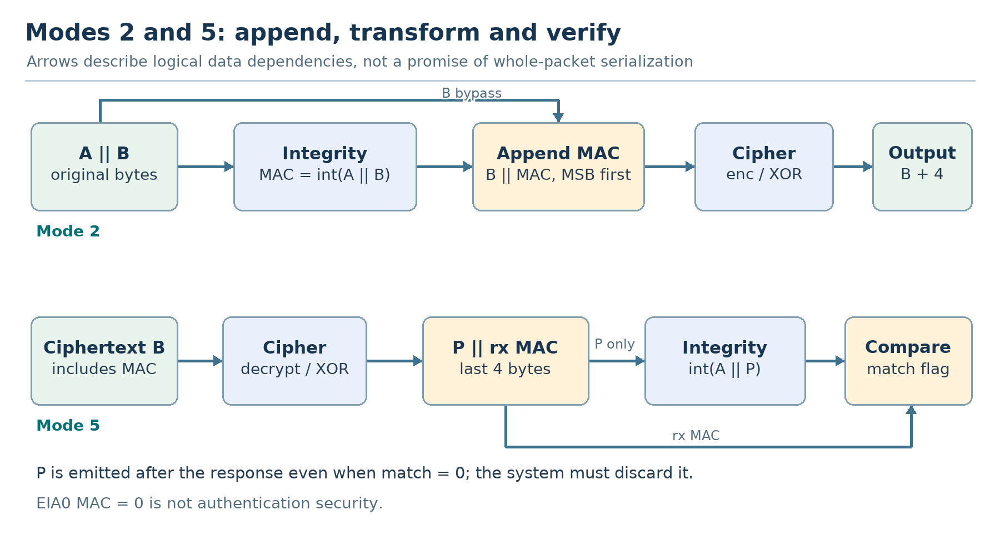

图为模式 2 / 5 的逻辑依赖，不要求硬件逐整包串行；B 中前部数据在依赖允许时可与完整性并发处理。模式 5 中完整性输入只有 `A || P`，接收 MAC 单独送比较，不再进入完整性消息。

模式 2 追加的 MAC 以高字节在前的 4 字节紧接 B；响应中的 `rsp_mac` 仍是加密前的值。模式 5 对应模式 2 的接收布局，不是模式 3 的直接逆过程。模式 5 中，MAC 不匹配时 `rsp_error=0`，`rsp_rx_mac_valid=1` 且 `rsp_mac_match=0`；RTL 不屏蔽明文，系统必须丢弃未认证数据。EIA0 的相等标志只是数值比较，没有认证安全性。

若完整性输入长度为 0，本接口对 EIA1 约定不处理消息块，直接执行长度/最终步骤；EIA3 返回前两个密钥流字的异或；EIA2 仍对 64-bit 协议前缀执行 CMAC。这些 RTL 的空消息行为不替代上层协议的最小消息长度约束。模式 5 的 B 恰好为 4 时，仅解密并检查验证码，无明文输出；模式 2 的 B 为 0 时仍输出 4 字节加密 MAC。

### 2.1.4 IV 和计数器在外围的构造

令 `prefix64={COUNT[31:0],BEARER[4:0],DIRECTION,26'b0}`。机密性通道中的 SNOW/ZUC IV 为 `{prefix64,prefix64}`；AES-CTR 输入块为 `{prefix64,counter64}`，counter 从 0 递增。EIA2 以 `prefix64` 开始 CMAC 消息。

对 EIA1/EIA3，令 `fresh={BEARER,27'b0}`，完整性通道传给流密码原语的 IV 为 `{COUNT,fresh,COUNT XOR {DIRECTION,31'b0},fresh XOR {16'b0,DIRECTION,15'b0}}`。各加密与完整性通道使用各自 key；key 和字节流的高位表示先出现的字节。

### 2.1.5 EEA0 / EEA1 / EEA2 / EEA3 数据变换

| 算法 | `u_cipher` 的计算步骤 |
| --- | --- |
| EEA0 | 选择 32-bit 全零密钥流；输出是输入有效字节，最后不足 4 字节的低位字节清零。 |
| EEA1 / EEA3 | 分别装载 SNOW 3G / ZUC 的 key 与 `{prefix64,prefix64}`；等待 32 次 INIT 和一次 DISCARD；每个 32-bit 输入/输出实际传输时消费一个密钥流字并前进状态。 |
| EEA2 | `counter64` 从 0 开始；逐块计算 `KS[j]=AES_K(prefix64 || j)`，计数器每次成功提交 AES 请求后递增；从每个 128-bit 结果高字节到低字节取流。 |
| 全部 | `out=(in XOR selected_keystream) AND byte_mask`；`out_bytes=min(left,4)`，`left` 只在实际传输后递减。XOR 同样用于加密和解密。 |

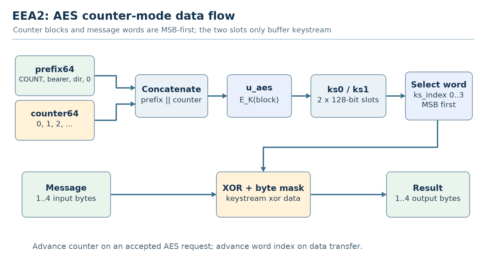

EEA2 的两个 128-bit 密钥流槽允许当前块和下一块重叠，但不保证每个周期都可传输 32 bit；AES 原语延迟、槽占用、输入/输出等待都会影响吞吐。两个通道各有独立原语，不共享计数器或 key。

### 2.1.6 EIA1 / EIA2 / EIA3 计算流程

令消息 `M` 为该模式选择的完整性输入，`L=8*len(M)`，字节和位均按高位先处理。EIA1/EIA3 的 COUNT、BEARER、DIRECTION 体现在 IV 中；EIA2 则将 `prefix64` 明确作为消息前 8 字节。EIA0 的 MAC 恒为零，不提供认证能力。

#### 2.1.6.1 EIA2 / AES-CMAC

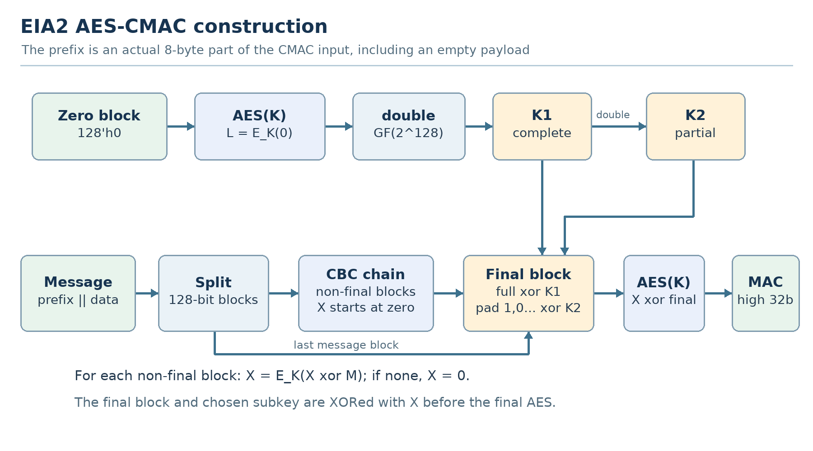

设 `Dbl(X)=((X<<1) mod 2^128) XOR (X[127] ? 0x87 : 0)`，先计算 `L0=AES_K(0^128)`、`K1=Dbl(L0)`、`K2=Dbl(K1)`。将 `prefix64 || M` 分为 128-bit 块，初始 `X=0`；每个非末块计算 `X=AES_K(X XOR block)`。末块恰好 128 bit 则与 K1 异或；不足 128 bit 则在有效消息后追加单个 `1` bit 和零填充，再与 K2 异或。最终 `T=AES_K(X XOR adjusted_last)`，`MAC=T[127:96]`。

当前接口是整字节，故不满块填充从 `0x80` 开始。空 M 时，CMAC 输入仍有 8 字节前缀，因此末块为 `{prefix64,8'h80,56'b0}` 并使用 K2。每次 AES 结果返回后才能启动依赖它的下一 CBC 块；这不是可按 AES 的块 II 独立流水的消息。

#### 2.1.6.2 EIA1 / SNOW 3G

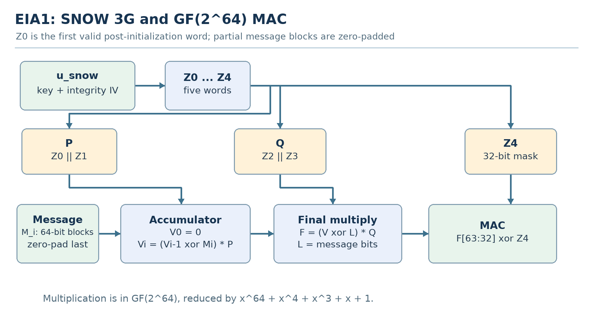

用完整性 IV 启动 SNOW 3G，依次取得五个 32-bit 字 `Z0…Z4`，令 `P={Z0,Z1}`、`Q={Z2,Z3}`。将 M 分为高位先的 64-bit 块 `M_i`，末块不足 64 bit 时低位补零；`V0=0`，逐块计算 `V_i=GF64_MUL(V_(i-1) XOR M_i,P)`。之后 `F=GF64_MUL(V_final XOR L,Q)`，`MAC=F[63:32] XOR Z4`。空 M 时不进行消息块乘法，直接从 `V0=0` 进行长度/最终步骤。

GF(2^64) 的约简多项式为 `x^64+x^4+x^3+x+1`；RTL 的移位乘法在最高位溢出时异或低位常数 `0x1b`，一个组合乘法函数在消息 P 步骤和最终 Q 步骤之间复用。输入接口每拍最多接收 32 bit，通常先缓存高 32 bit 再形成 64-bit 消息块。

#### 2.1.6.3 EIA3 / ZUC

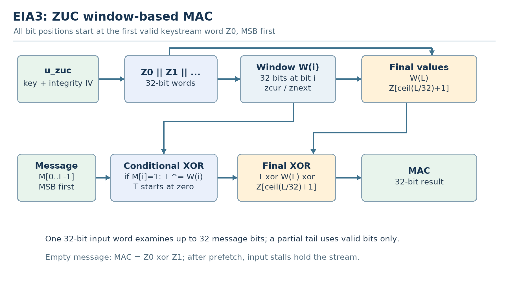

用完整性 IV 启动 ZUC，按生成顺序定义 32-bit 密钥流字 `Z0,Z1,…` 和从拼接字流第 i 位起的 32-bit 窗口 `W(i)`。初始化累加器 `T=0`；对 `i=0…L-1`，若 M 的第 i 个高位先比特为 1，则 `T=T XOR W(i)`；最后 `MAC=T XOR W(L) XOR Z[ceil(L/32)+1]`。当 L=0 时该式退化为 `Z0 XOR Z1`。

RTL 保持相邻两个 32-bit 密钥流字 `zcur/znext` 并在一个输入字内组合处理最多 32 个消息位；最后部分字仅处理 `8*bytes_now` 个消息位，其中 `bytes_now=min(left,4)`。该描述的 `Z0` 从工作期第一个有效流字开始编号；实际 ZUC 初始丢弃字不计入。

## 2.2 Microarchitecture Analysis

### 2.2.1 Top Level Diagram

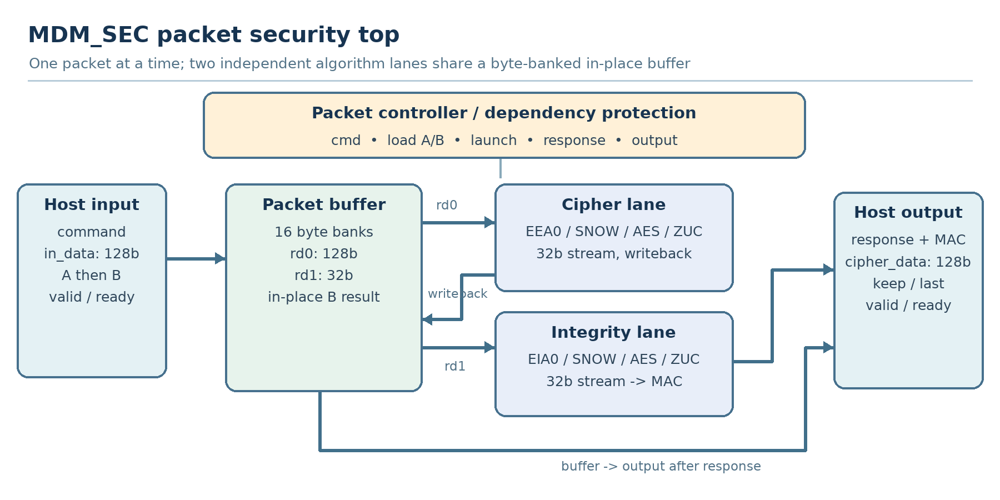

| 主要层次 | 角色 |
| --- | --- |
| `mdm_sec` 控制和命令寄存器 | 命令合法性、A/B 装载、长度/指针、调度、响应与输出握手。 |
| `u_input_buffer : mdm_packet_buffer` | 16 个字节 bank 的共享存储；装入 A/B，并原地保存 B 的结果。 |
| `u_cipher : mdm_cipher` | 32-bit 机密性通道，包含 `u_aes/u_snow/u_zuc` 和 AES 密钥流缓冲。 |
| `u_integrity : mdm_integrity` | 32-bit 完整性通道，包含独立 `u_aes/u_snow/u_zuc` 和 MAC 计算逻辑。 |
| 同步/依赖保护 | `enc_mem_ready`、`enc_mac_ready`、`int_dep_ready` 等控制数据能否被消费或覆盖。 |

两条通道各静态实例化一套 AES、SNOW 3G 和 ZUC 原语；AES 包装器通过参数在低面积、原高速及 5 拍优化实现中静态选择。算法 ID 为运行时选择，不等于同一原语被两个通道共享。

#### 2.2.1.1 u_cipher 机密性通道设计框图

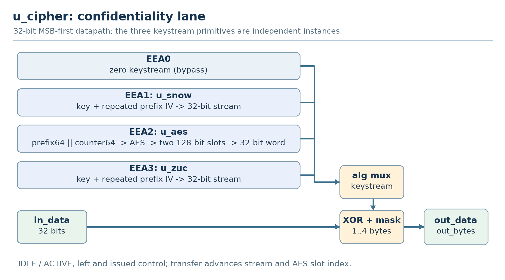

图中的四路是按 `alg` 静态存在、运行时选择的逻辑，`u_aes/u_snow/u_zuc` 均位于 `u_cipher` 之下。EEA2 的 `ks0/ks1` 是两个 128-bit **密钥流**暂存槽，不是两个输入包缓存；`ks_index` 按高字先选取其中一个 32-bit 字。`aes_counter` 从 0 开始，`issued` 跟踪已提交的字节范围，槽、AES busy/done 共同参与预取空间预留。

| 内部接口或控制 | 实现及顶层连接 |
| --- | --- |
| `start/alg/key/count/bearer/direction/length` | 启动沿锁存算法和参数；顶层在 RUN 产生 `enc_start`，length 为 `enc_len`。 |
| `in_valid/in_ready/in_data` | 输入为高位在前 32 bit；`in_ready=active && out_ready && available`；`available` 是当前算法流已备好或 EEA0。 |
| `out_valid/out_ready/out_data/out_bytes` | `out_valid=active && in_valid && available`；顶层把 `out_ready` 接 1，输出被写回共享缓冲。`out_bytes` 为 16-bit 端口，数值 1～4。 |
| `transfer/done/left` | `transfer=out_valid && out_ready` 时前进数据和对应密钥流；最后字传输后 `done` 脉冲。启动长度为 0 时直接给出 done，不产生数据。 |
| `state` | IDLE / ACTIVE；从单次 start 到最后一次 32-bit 传输完成；不是跨包流水。 |

#### 2.2.1.2 u_integrity 完整性通道设计框图

用户所称 `u_inte` 在当前 `mdm_sec` RTL 中的实际实例名为 **u_integrity**，模块为 `mdm_integrity`；仓库没有名为 `u_inte` 的实例。后续层次、SDC 和波形应使用实际名称。

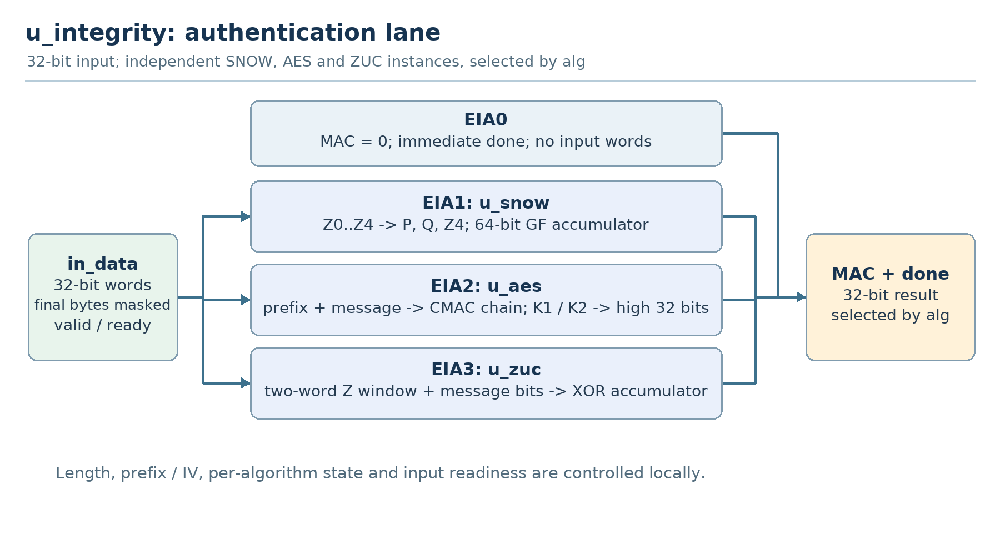

输入的 `length` 是顶层按模式算出的 `int_len`，通道根据剩余字节数对末尾 32-bit 字的低位做屏蔽；`in_valid && in_ready` 才消费消息。`mac/done` 接回顶层的 `calculated_mac/int_done`；通道只计算 MAC，不负责模式 5 的接收 MAC 提取和最终比较。

| 算法 / 状态 | 主要硬件和流程 |
| --- | --- |
| EIA0 | start 后 MAC=0 且 done；不消费输入字。 |
| EIA1 | `SNOW_KEYS -> SNOW_DATA -> SNOW_FINAL`；独立 `u_snow` 产生 5 字密钥流，64-bit `p/q/eval_reg` 与复用 GF64 乘法器计算；空消息从 KEYS 直接到 FINAL。 |
| EIA2 | `AES_L_REQ/WAIT -> AES_COLLECT -> AES_BLOCK_REQ/WAIT`；独立 `u_aes` 生成 L、K1/K2 和逐块 CBC 链，非末块返回 COLLECT；空消息在 L_WAIT 后直接计算前缀末块。 |
| EIA3 | `ZUC_FIRST -> ZUC_SECOND -> ZUC_DATA`；独立 `u_zuc`、`zcur/znext/zacc` 和消息位窗口形成 MAC；空消息在 SECOND 结束。 |
| 参数 | `AES_LOW_AREA=2` 时，仅此通道由 `AES_INTEGRITY_TIMING_OPT` 选择时序候选或原 balanced；仓库的 `u_cipher` 不受此开关影响。 |

#### 2.2.1.3 u_cipher 与 u_integrity 交互设计框图

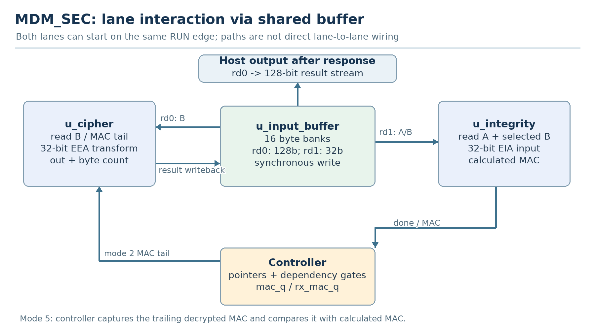

两路之间没有直接的数据端口相连：cipher 从缓冲 rd0 读取 B 并将变换结果同步原地写回，integrity 从 rd1 读取 A 和所需版本的 B。顶层在模式 2 从 `mac_q` 拼接待加密的 4 字节，在模式 5 通过 `rx_mac_q` 滚动保存解密流最后四字节并与计算 MAC 比较。缓冲读旧值、写提交顺序和指针门控见 2.2.5；图中线条不表示新增寄存器或外部接口。

| 顶层信号 | 含义 / 交互点 |
| --- | --- |
| `enc_start` / `int_start` | RUN 中分别在所需通道尚未启动时有效；模式 2～5 两个通道同沿启动。 |
| `enc_pos` / `int_pos` | 分别记录已写回 cipher 字节数和已消费完整性字节数。 |
| `enc_mem_ready` / `enc_mac_ready` | 模式 2/4 防覆盖原数据；模式 2 追加 MAC 的字还等待完整性完成。 |
| `int_dep_ready` | 模式 3/5 对产生结果的 B 区域仅允许读取先前沿已写回的数据；完整性可先消费 A。 |
| `calculated_mac` / `mac_q` | `int_done` 后顶层锁存的计算 MAC；模式 2 用于追加，模式 5 用于比较。 |
| `rx_mac_q` / `rsp_mac_match` | 模式 5 按 cipher 输出滚动获取末四字节；与计算 MAC 数值比较，认证失败不阻止输出。 |

### 2.2.2 Timing Requirement

所有接口和内部寄存器属于同一 `clk` 域，`rst_n` 异步低有效；本设计不含 reset release 同步器或 CDC 桥。每次接口传输由对应 valid/ready 在上升沿同时为 1 定义。物理输入延迟、输出延迟、频率、时钟不确定度、复位 recovery/removal 由集成约束提供，当前为 TBD。

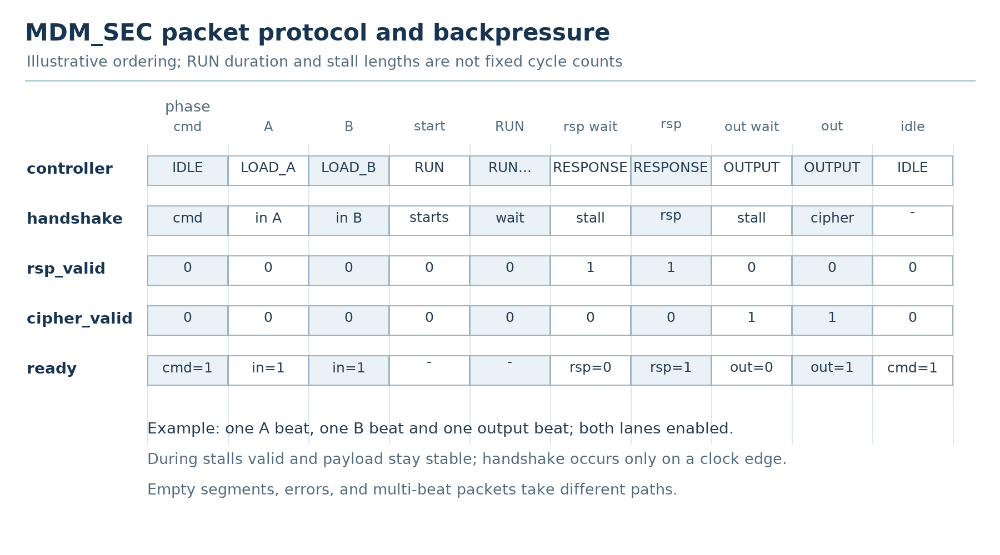

该图是阶段顺序示意，列宽**不代表固定周期数**。例子假设 A、B、输出各 1 beat，两条通道启用，响应和输出各遇一次反压；`rsp_valid`/`cipher_valid` 在被阻塞时保持，握手后才转入下一阶段。零长度、非法命令、多 beat 或不同算法的时序不同。

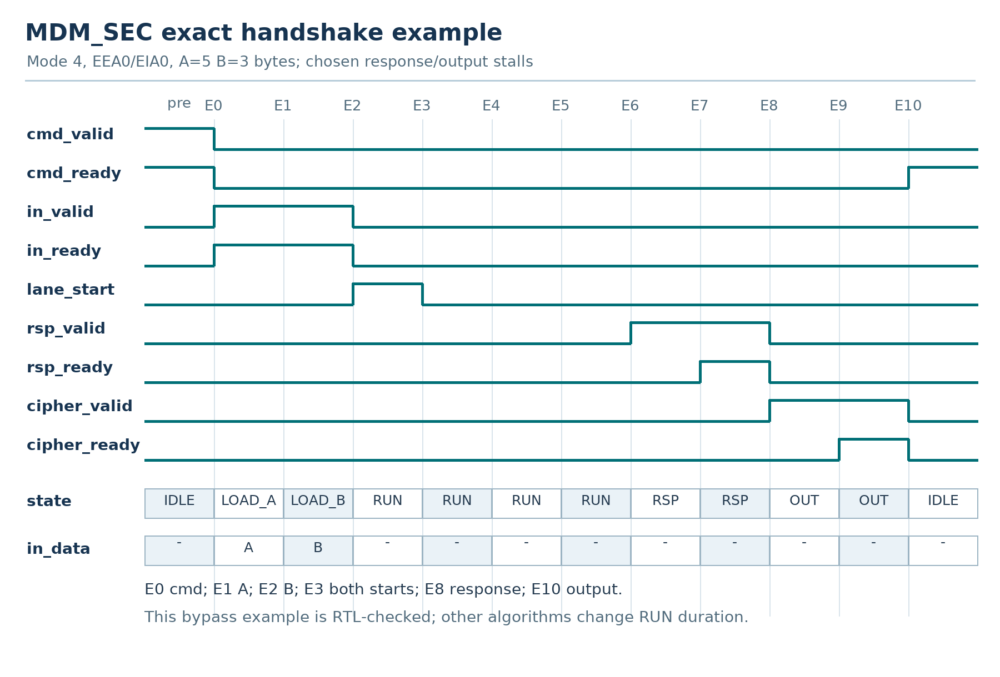

逐沿图为一个可由 `tests/rtl/tb_spec_timing.sv` 自检的具体例子：模式 4、EEA0/EIA0、A=5 字节、B=3 字节。E0 命令、E1 A、E2 B，E3 两路启动；E6 沿后 `rsp_valid=1`，E7 暂停，E8 响应握手；E8 沿后 `cipher_valid=1`，E9 暂停，E10 输出握手返回 IDLE。输出为 `667788`、`keep=e000`、`last=1`。此示例使用 NULL 算法，不是 SNOW/AES/ZUC 的固定整包延迟承诺。

| 阶段 | 时序和行为 |
| --- | --- |
| 命令 | `cmd_valid && cmd_ready` 采样命令；成功后选择 A/B 装载，非法命令直接转响应。 |
| 输入 | 每个非空 A、B 分段分别占 `ceil(length/16)` 次 128-bit 传输；任一 valid/ready 不满足可暂停。 |
| 处理 | 全部输入写完后进入 RUN；模式 2～5 的两个 start 同沿有效；具体计算时长取决于算法和依赖等待。 |
| 响应 | 两条所需通道都结束后 `rsp_valid=1`，直到 `rsp_ready`；无固定整包响应周期。 |
| 输出 | 响应握手之后才进入 OUTPUT；每个 beat 可被 `cipher_ready` 暂停。零长度没有输出 beat。 |
| 下一命令 | 零输出在响应握手后返回 IDLE；非零输出在最后 beat 握手后返回 IDLE。 |

未考虑暂停时，输入至少需要 `ceil(A/16)+ceil(B/16)` 次传输，输出需要 `ceil(C/16)` 次传输；整包延迟还包括命令、阶段转换、算法初始化/执行、响应及反压，不能简单把原语 II 乘以块数当成总延迟。

### 2.2.3 Peripheral Interface

本顶层使用四组自定义同步握手，不是宣称符合 AXI4-Stream 全部协议：命令 `cmd_*`、输入 `in_*`、响应 `rsp_*` 和结果 `cipher_*`。输入端无 keep/last，A/B 长度来自命令，且两段各自独立开始一个 128-bit beat。

上游对合法命令送完全部数据；非法命令不会接受数据而直接响应，因此上游在等待 `in_ready` 时必须同时处理错误响应，避免死锁。下游先接收响应，再排空指定长度的 cipher 数据；即使模式 5 认证失败、上层打算丢弃明文，也需要握手排空或复位中止。

### 2.2.4 Sub-modules

| 模块 | 数据接口 / 主要职责 |
| --- | --- |
| `mdm_packet_buffer` | 16 个 8-bit bank，一个同步写端口；rd0 为 128-bit 异步组合读，rd1 为 32-bit 异步组合读。 |
| `mdm_cipher` | 32-bit 输入/输出，EEA0 bypass；EEA1/3 流密码；EEA2 AES-CTR，两个密钥流缓冲槽。 |
| `mdm_integrity` | 32-bit 输入；EIA0/1/2/3，包含 GF(2^64)、AES-CMAC 和 ZUC bit 窗口逻辑。 |
| `mdm_aes128` | 两通道各 1 个；AES_LOW_AREA=1/0/2 分别为 50/5/5 周期块原语。 |
| `mdm_snow3g` / `mdm_zuc` | 两通道各 1 个；32 次初始化 + 一次丢弃后可每拍推进 32-bit 字。 |
| 顶层 FSM | IDLE、LOAD_A、LOAD_B、RUN、RESPONSE、OUTPUT，单包控制与协议约束。 |

### 2.2.5 Pipeline Design and Dependency Control

输入 A/B 必须全部写入共享缓冲后才启动算法。模式 2～5 的 `enc_start` 和 `int_start` 同拍发出；本设计不是跨包流水，不能在本包输出期间接收下一包。两通道可同时传输，但不同原语、初始化、部分字和依赖可能导致速率不同。

| 模式 | 数据依赖和保护 |
| --- | --- |
| 0/1 | 分别只启动 cipher 或 integrity；模式 1 的原 B 保留在缓冲中用于输出。 |
| 2 | integrity 需要原始 B；cipher 覆盖原 B 前等待相应字节被读取，允许同沿读旧值。含追加 MAC 的字还须等待 MAC 完成。 |
| 3 | integrity 先消费 A；需要 B 段时，只读取此前时钟沿已经写回的密文。 |
| 4 | integrity 消费原始 A/B；cipher 写回不能覆盖尚未被 integrity 读取的原 B，允许同沿读旧值。 |
| 5 | cipher 解密整个 B；integrity 可先消费 A，之后等待此前沿写回的明文。末 4 字节经滚动窗口提取，不进入明文输出/认证输入。 |

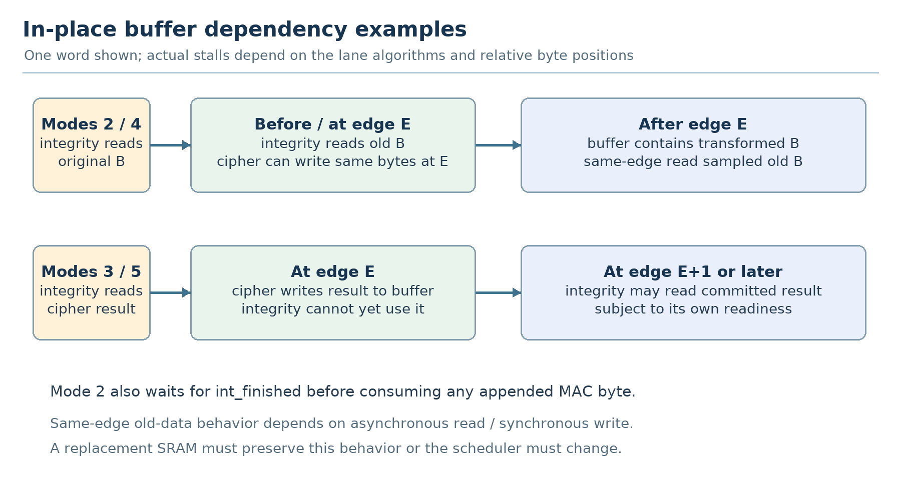

`enc_mem_ready` 实现模式 2/4 原文覆盖保护；`enc_mac_ready` 防止模式 2 过早使用附加 MAC；`int_dep_ready` 限制模式 3/5 消费尚未提交的结果。这里的同拍“读旧值”依赖 `mdm_packet_buffer` 的异步读/同步写语义；替换成 SRAM 时必须满足等价语义，或重新设计调度。

以下为 RTL 指针门控的等价整理，字节位置以缓冲 A 起点为 0；`enc_pos` 相对 B，`int_pos` 相对 A。`int_take=int_in_valid && int_in_ready`；`enc_chunk/int_chunk` 均为当前最多 4 字节的请求长度。

```text
int_end = int_pos + int_chunk
result_needed = max(int_end - a_len, 0)
int_dep_ready = (mode not in {3,5}) OR (enc_pos >= result_needed)

old_b_end = min(enc_pos + enc_chunk, b_len)
old_input_end = a_len + old_b_end
int_read_end = int_take ? int_end : int_pos
enc_mem_ready = (mode not in {2,4}) OR (enc_pos >= b_len)
                OR (int_alg == EIA0) OR int_finished
                OR (old_input_end <= int_read_end)
enc_mac_ready = (mode != 2) OR (enc_chunk <= enc_b_left) OR int_finished
enc_in_valid = RUN AND enc_started AND not enc_finished
               AND (enc_pos < enc_len) AND enc_mem_ready AND enc_mac_ready
```

模式 2/4 若同沿 `int_take` 读取原字，则 `int_read_end` 已包含这次读取，可允许 cipher 同沿写回；模式 3/5 的 `enc_pos` 是先前写回沿之后更新的寄存器，因此新结果最早在下一沿供 integrity 消费。模式 2 若一个 32-bit 字横跨 B 尾和 MAC 首字节，即使只有一字节属于 MAC，也需等 `int_finished` 后整体传输。

### 2.2.6 State Machine

| 状态 | 作用与主要转移 |
| --- | --- |
| IDLE | `cmd_ready=1`；合法命令进入 LOAD_A、LOAD_B 或 RUN，非法命令进入 RESPONSE。 |
| LOAD_A | 通过输入握手装 A；完成后若 B 非空进入 LOAD_B，否则进入 RUN。 |
| LOAD_B | 通过输入握手装 B；最后一拍后进入 RUN。 |
| RUN | 启动并等待所需 cipher/integrity，处理依赖、写回结果并捕获 MAC。 |
| RESPONSE | 保持响应直到 `rsp_ready`；长度为 0 返回 IDLE，否则进入 OUTPUT。 |
| OUTPUT | 按 `cipher_ready` 输出结果；最后 beat 握手返回 IDLE。 |

### 2.2.7 Buffer and Storage

内部逻辑容量为 `min(MAX_BYTES+4,65536)` 字节；bank 行数为 `ceil(capacity/16)`，物理声明位数为 `16 × ceil(capacity/16) × 8`。默认 `MAX_BYTES=2048` 时逻辑容量 2052 字节、129 行、声明存储 **16,512 bit**（包括 bank 行填充）。

输入按 A 后接 B 连续存储，A/B 在外部 beat 边界分别对齐但在内部字节地址上可不对齐。计算期间 rd0 供 cipher、rd1 供 integrity；cipher 输出原地写回 B。响应完成后 rd0 改作 128-bit 输出。通用 RTL 的读为异步组合读、写为上升沿同步写；同沿读写依赖采样旧值，写后显示新值。

当 `MAX_BYTES` 大于 65532 时缓冲是 65536 字节环；模式 2 的追加 MAC 可按 16-bit 地址回绕至已经消费完的 A 空间。`B+4` 必须可由 16 bit 表示；在不同 SRAM 端口、读延迟和碰撞模式下，此行为需重新验证。复位不擦除 bank 存储内容。

### 2.2.8 Resource Consumption

| 资源 | 当前结构 / 已知范围 |
| --- | --- |
| AES 原语 | 每个通道 1 个，共 2 个；共用 `AES_LOW_AREA`，其值为 2 时完整性可单独选择 5 拍时序候选。 |
| SNOW 3G / ZUC | 每个通道分别各 1 个；共 2 个 SNOW 和 2 个 ZUC。 |
| 默认共享缓冲 | 16 bank × 129 行 × 8 bit = 16,512 声明 bit，另有读写地址和旋转逻辑。 |
| AES-CTR 缓冲 | cipher 通道 2 个 128-bit 密钥流槽及有效位。 |
| 完整性运算 | EIA1 共用一个组合 GF(2^64) 乘法函数；EIA2 CMAC；EIA3 32-bit 输入 bit 窗口组合逻辑。 |
| 物理 SRAM、标准单元面积 | TBD；异步双读和碰撞语义未保证可直接推断目标 SRAM。 |

### 2.2.9 Synthesis Analysis

已有 Yosys 0.64 的历史通用逻辑统计采用 `synth -noabc; check -assert; stat`、`MAX_BYTES=2048`，内存映射成触发器及选择逻辑：低面积配置顶层 **107,643 个通用单元**，高速配置 **117,931 个通用单元**。该统计对不同单元一律按 1 个计数，不是标准单元面积、门等效数、SRAM 面积或时序；环境和脚本见 `docs/area_optimization.md`。

| 待填项 | 结果 |
| --- | --- |
| Synopsys 工具版本、工艺库、PVT | TBD |
| `MAX_BYTES`、`AES_LOW_AREA`、`AES_INTEGRITY_TIMING_OPT`、SDC 及存储宏 | TBD |
| 寄存器/组合面积、SRAM 面积、总面积 | TBD |
| 时钟周期、WNS/TNS、关键路径和约束覆盖 | TBD |
| 布线后面积/频率、DFT/scan 开销 | TBD |

需要对三种 AES 配置在同一目标库/约束下比较，重点检查共享缓冲两读端、非对齐旋转、读写碰撞、EIA1 GF 乘法、EIA3 窗口和高速 AES 两轮组合路径。实际宏若是同步读，应重新调整流水/仲裁，不能只替换存储实例。

### 2.2.10 Power Analysis

当前 RTL 未提供功耗域、隔离、保留寄存器或专用时钟门控策略。不同模式、原语初始化、等待、存储实现和外部反压会显著改变活动率；源代码无法得出可信的工艺功耗数字。

| 待填项 | 结果 |
| --- | --- |
| 库、PVT、时钟、负载和工况 | TBD |
| 各模式平均/峰值动态功耗 | TBD |
| 静态、待机和时钟网络功耗 | TBD |
| SAIF/VCD/FSDB 活动率来源、覆盖率和向量版本 | TBD |

### 2.2.11 Debug and Trace

包级仿真顶层为 `tb_mdm_sec`，被测实例为 `dut : mdm_sec`；`tb_aes_random` 是独立 AES 仿真顶层，不是包级子层次。观察 `cmd_valid/cmd_ready`、`in_valid/in_ready`、`rsp_valid/rsp_ready`、`cipher_valid/cipher_ready` 及 `cipher_keep/last`。

进一步观察 `dut.state`、`mode_q`、`enc_start/int_start`、`enc_pos/int_pos`、`enc_mem_ready/enc_mac_ready/int_dep_ready`、`u_input_buffer.wr_*` / `rd*` 和响应 MAC。定向波形 `wave_case_id` 11/12 分别为模式 5 认证成功/篡改；缓存数组可能需要 FSDB MDA。`docs/u_network_test.md` 给出外网生成向量、U 网 VCS/Verdi 的分离流程；FSDB 中的密钥、数据和中间状态必须受控。

### 2.2.12 Verification and Acceptance

| 验证项目 | 既有结果 / 限制 |
| --- | --- |
| 包级大规模回归 | Verilator：低面积 2641+240+12 包，原高速、balanced 候选和回退配置各 2641+12 包；覆盖六模式、算法组合、长度、背压和依赖。 |
| 波形定向包 | 低面积、原高速和 5 拍优化配置各 20 包；包括模式 5 成功/失败、同沿读旧值和关键依赖等待。 |
| AES 原语 | 低面积、原高速、原 balanced 和时序候选四种实现各 515 块；检查固定答案、50/5/5/5 周期延迟与 II。 |
| 其他原语和缓存 | SNOW/ZUC 已知答案及 stall；缓冲最小/一般/最大容量和读写碰撞回归。 |
| 外网/U 网转运 | 外网生成并打包向量，U 网采用无需项目 Python/Make 的 `run.sh`；默认定向测试使用 20 包及 8 个 AES 块。mock 检查不等于真实 VCS/PLI。 |
| 未完成 | 当前执行环境没有真实 VCS/Verdi 许可；原生 FSDB、目标工艺综合网表/STA、门级、系统级形式和安全认证需另行确认。优化 AES 的局部形式检查见其独立规格书。 |

# 3 I/O Interface

## 3.1 Parameters and Configuration

| 参数 | 默认值 | 合法范围 / 作用 |
| --- | --- | --- |
| `MAX_BYTES` | 2048 | 整数 1～65535；限制输入 `A+B` 字节数，内部缓冲最多额外容纳 4 字节。 |
| `AES_LOW_AREA` | 1 | 1 为 50 周期低面积，0 为原 5 周期高速，2 为 5 周期 balanced；影响 cipher 与 integrity 两个 AES 实例。 |
| `AES_INTEGRITY_TIMING_OPT` | 1 | 仅在 `AES_LOW_AREA=2` 时影响 integrity：1 为时序候选、0 为原 balanced；不影响 cipher，其他值非法。 |

参数在 elaboration 时固定，不是命令寄存器；非法配置在 RTL 仿真/层次检查中报错，不是运行时 `rsp_error`。

## 3.2 Clock and Reset Ports

| 信号 | 方向 | 位宽 | 描述 |
| --- | --- | --- | --- |
| `clk` | 输入 | 1 | 所有同步握手、控制及存储写入使用的上升沿时钟。 |
| `rst_n` | 输入 | 1 | 异步低有效复位；复位中 `cmd_ready=0`，中止当前包；释放由外部同步。 |

## 3.3 Command Interface

| 信号 | 方向 | 位宽 | 描述 |
| --- | --- | --- | --- |
| `cmd_valid` | 输入 | 1 | 命令有效；阻塞时与所有命令字段保持稳定。 |
| `cmd_ready` | 输出 | 1 | IDLE 且不在复位时可接受命令。 |
| `cmd_mode` | 输入 | 3 | 模式 0～5；6/7 非法。 |
| `cmd_cipher_alg` | 输入 | 2 | 机密性算法 ID 0～3。 |
| `cmd_int_alg` | 输入 | 2 | 完整性算法 ID 0～3。 |
| `cmd_cipher_key` | 输入 | 128 | 机密性 key；握手时采样，高字节在高位。 |
| `cmd_int_key` | 输入 | 128 | 完整性 key；握手时采样，高字节在高位。 |
| `cmd_count` | 输入 | 32 | COUNT 协议参数，不是消息长度。 |
| `cmd_bearer` | 输入 | 5 | BEARER 协议参数。 |
| `cmd_direction` | 输入 | 1 | DIRECTION 协议参数，不是加密/解密操作开关。 |
| `cmd_a_bytes` | 输入 | 16 | A 的字节数，可为 0。 |
| `cmd_b_bytes` | 输入 | 16 | B 的字节数，可为 0；模式 5 不得小于 4。 |

## 3.4 Input Data Interface

| 信号 | 方向 | 位宽 | 描述 |
| --- | --- | --- | --- |
| `in_valid` | 输入 | 1 | 输入 beat 有效；等待时保持数据和 valid。 |
| `in_ready` | 输出 | 1 | LOAD_A/LOAD_B 时可接受当前 beat。 |
| `in_data` | 输入 | 128 | 每段高字节先，每 beat 最多 16 字节；最后无效低字节被忽略。 |

A 的最后一个不满 16 字节 beat 和 B 的第一个 beat **不可合并**；两段分别起始。A/B 为零时不发送对应 beat。无输入 keep/last，必须按命令长度精确提供数据。

## 3.5 Response Interface

| 信号 | 方向 | 位宽 | 描述 |
| --- | --- | --- | --- |
| `rsp_valid` | 输出 | 1 | 响应有效，直到 rsp_ready 握手；负载保持。 |
| `rsp_ready` | 输入 | 1 | 上游接受响应。 |
| `rsp_mac` | 输出 | 32 | 计算 MAC；模式 0 无效且为 0，其他合法模式按 `rsp_mac_valid` 使用。 |
| `rsp_mac_valid` | 输出 | 1 | 本命令是否请求完整性；合法 EIA0 也为 1。 |
| `rsp_cipher_bytes` | 输出 | 16 | 后续 cipher 流字节数；模式 2 为 B+4，模式 5 为 B-4。 |
| `rsp_error` | 输出 | 1 | 非法模式、长度/溢出等命令错误；不是认证匹配标志。 |
| `rsp_rx_mac` | 输出 | 32 | 模式 5 解密后提取的末 4 字节，大端序。 |
| `rsp_rx_mac_valid` | 输出 | 1 | 模式 5 的接收 MAC 有效；其他模式和非法命令为 0。 |
| `rsp_mac_match` | 输出 | 1 | 模式 5 计算 MAC 与接收 MAC 数值相等；仅响应有效且接收 MAC 有效时解释。 |

响应寄存器可在握手后保持原值；系统必须以 `rsp_valid`/`rsp_rx_mac_valid` 判定含义，不能将保持的旧值当新响应。

## 3.6 Cipher Output Interface

| 信号 | 方向 | 位宽 | 描述 |
| --- | --- | --- | --- |
| `cipher_valid` | 输出 | 1 | 响应握手后的输出 beat 有效；等待 ready 时保持。 |
| `cipher_ready` | 输入 | 1 | 下游接收当前 beat。 |
| `cipher_data` | 输出 | 128 | 结果字节高位先；无效的尾部低位字节填 0。 |
| `cipher_keep` | 输出 | 16 | 连续高位 1 表示有效字节；bit 15 对应 data[127:120]。 |
| `cipher_last` | 输出 | 1 | 当前为最后一个 beat；只在 valid 期间解释。 |

16/15/3/1 个有效字节分别对应 `keep=ffff/fffe/e000/8000`。`cipher_valid=0` 时当前 RTL 将 data、keep 和 last 驱为 0。输出长度为零时不产生 beat。

## 3.7 Command Rejection and Reset

| 条件 | 响应行为 |
| --- | --- |
| mode > 5 | `rsp_error=1`，不接收数据。 |
| `A+B > 65535` 或 `A+B > MAX_BYTES` | 报错，不截断长度、不接收数据。 |
| mode 2 且 B > 65531 | B+4 不能用 16 bit 表示，报错。 |
| mode 5 且 B < 4 | 无法提取完整验证码，报错。 |
| 非法命令共同响应 | `rsp_mac=0`、`rsp_mac_valid=0`、`rsp_cipher_bytes=0`、接收 MAC 无效，无 cipher beat。 |
| 异步 reset | 立即中止当前包、清控制/算法寄存器；共享缓冲不擦除；不产生完成响应。 |

## 3.8 Worked Transaction

以下为 `examples/tb_mdm_sec_quickstart.sv` 的测试数据，不可用于真实密钥：模式 4，cipher/int 算法 ID 均为 2，`COUNT=398a59b4`、`BEARER=15` 十六进制、`DIRECTION=1`；cipher key 为 `000102030405060708090a0b0c0d0e0f`，integrity key 为 `0f0e0d0c0b0a09080706050403020100`。

```text
A = 11 22 33 44 55; B = 66 77 88
input beat A = 11223344550000000000000000000000
input beat B = 66778800000000000000000000000000
response: mac=f387a200, mac_valid=1, cipher_bytes=3, error=0
output:   data=73830000000000000000000000000000, keep=e000, last=1
```

该实例验证 A/B 分段、AES-CTR、AES-CMAC、响应先于输出及高位 keep；不能据此推断其他模式的固定延迟。

# 4 Open Issue

| 编号 | 未决事项 / 风险 | 状态与建议负责人 |
| --- | --- | --- |
| MDM-OI-01 | 目标工艺库、存储宏、SDC、时钟和 Synopsys 实际面积/时序报告未提供。 | Open；综合/STA 团队。 |
| MDM-OI-02 | 异步双读、非对齐访问和同沿读旧值可能不匹配目标 SRAM；若调整接口或流水须回归。 | Open；存储与 RTL 团队。 |
| MDM-OI-03 | 模式 5 认证失败仍输出明文；上游必须隔离/丢弃且排空，系统安全协议待确认。 | Open；系统/安全团队。 |
| MDM-OI-04 | 缓冲不随复位擦除，完成后无专用 zeroization；密钥与数据残留处置待设计。 | Open；安全架构团队。 |
| MDM-OI-05 | 未实现非字节长度、重放防护、密钥生命周期管理和侧信道/故障注入防护。 | Open；产品/安全团队。 |
| MDM-OI-06 | 目标功耗、时钟门控、功耗域和活动率待填。 | Open；低功耗团队。 |
| MDM-OI-07 | 真正 U 网 VCS/Verdi、FSDB、目标工艺门级/形式及安全认证结果待补。 | Open；验证团队。 |
| MDM-OI-08 | 复位释放同步、CDC、DFT/scan、测试模式及接口 backpressure 上限待集成确认。 | Open；SoC/DFT/验证团队。 |
