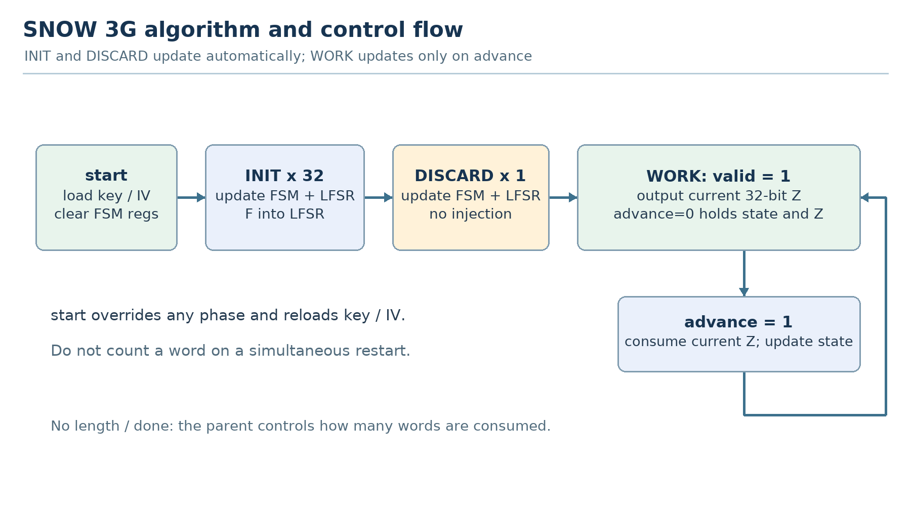
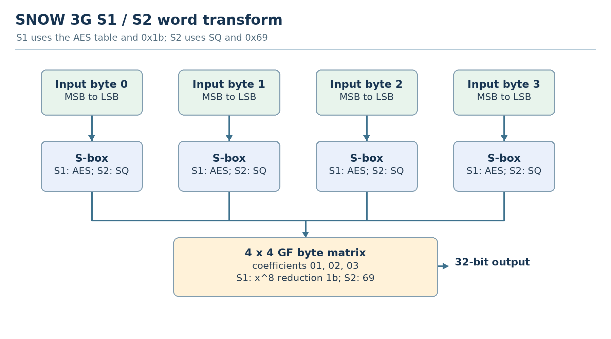
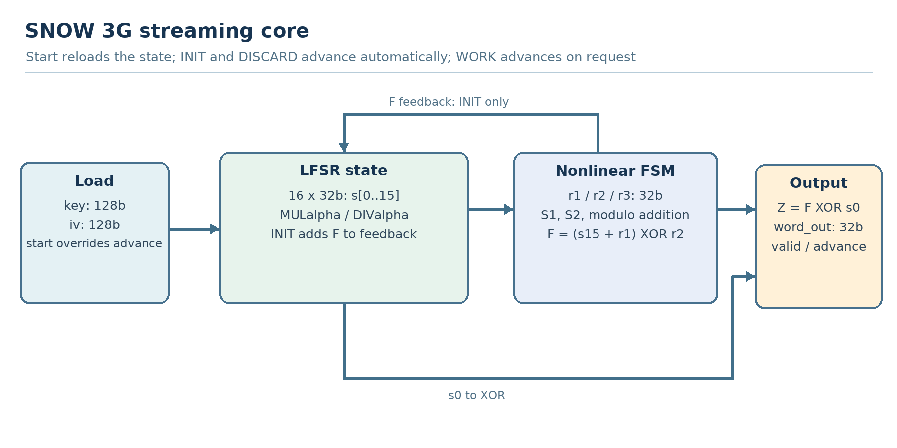
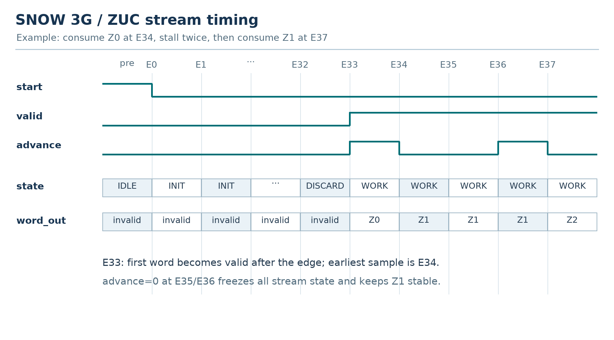

# 1 Introduction

## 1.1 Purpose

本文描述 MDM_SEC 工程中 SNOW 3G 密钥流原语的 RTL 微架构、输入输出、启动/暂停/重新启动时序以及集成约束。用户所称 **snow3g_core** 对应当前 Verilog 模块 `mdm_snow3g`；不存在名为 `snow3g_core` 的独立 module。

本规范以 RTL 基线为准，供设计、验证和综合人员评审；规格中的周期数为 RTL 周期行为，不是经目标工艺签核的时钟频率。物理面积、功耗和时序数据在目标工具及工艺明确前保留 TBD。

## 1.2 Scope

范围包括 128-bit key 和 IV 的装载、32 次初始化、一次丢弃、32-bit 密钥流输出、按字推进、暂停和复位。模块本身只生成密钥流，不接收明文、不输出 MAC、也不执行 3GPP 协议参数到 IV 的映射。

在 `mdm_sec` 中，`mdm_cipher` 将本核用于 EEA1 加解密的 XOR 密钥流；`mdm_integrity` 将独立实例用于 EIA1 的密钥流及完整性计算。两个通道的密钥、状态和实例彼此独立。

## 1.3 Defines, Symbols, and Abbreviations

| 术语 | 定义 |
| --- | --- |
| SNOW 3G | 3GPP 采用的 128-bit key、128-bit IV 流密码原语。 |
| LFSR | 16 级、每级 32 bit 的线性反馈移位寄存器，RTL 变量为 `s[0:15]`。 |
| FSM | 算法非线性有限状态机，此处含 `r1/r2/r3`；与外围控制 FSM 分别描述。 |
| F | 算法 FSM 的 32-bit 组合输出。 |
| Z / word | 32-bit 密钥流字，RTL `word_out = F XOR s[0]`。 |
| INIT / DISCARD / WORK | 初始化反馈、丢弃首轮、正常出流阶段。 |
| E0 / En | E0 为 `start` 有效采样沿；En 为此后的第 n 个上升沿。 |
| `advance` | 消费当前密钥流字并请求状态前进一步的输入；不是数据输出的 ready 信号名。 |
| K3…K0 / IV3…IV0 | 高位到低位各 32 bit 的 key 与 IV 字。 |
| EEA1 / EIA1 | 分别基于 SNOW 3G 的 3GPP 机密性和完整性构造，由外围通道完成。 |

## 1.4 Design Features

| 项目 | 当前实现 |
| --- | --- |
| 模块/文件 | `mdm_snow3g`，`rtl/mdm_snow3g.v`；函数包含于 `rtl/mdm_sboxes.vh`。 |
| Key / IV / output | 128 / 128 / 32 bit；输入按高字节在高位的标准字节串表示。 |
| 初始化 | 启动采样后 32 个 INIT 状态更新沿 + 1 个 DISCARD 更新沿。 |
| 正常出流 | `valid=1` 表示 WORK；在无启动和复位干扰时，`valid && advance` 每拍消费一个 32-bit 字。 |
| 暂停 | WORK 且 `advance=0` 时 LFSR/FSM 保持，`word_out` 保持。 |
| 重新启动 | 任何状态下 `start=1` 均优先装载新 key/IV 并重入 INIT，不设 busy/ready。 |
| 时钟 / 复位 | 单时钟上升沿、异步低有效复位；释放同步由外部负责。 |

## 1.5 References

| 编号 | 资料与用途 |
| --- | --- |
| R1 | 3GPP TS 35.216, UEA2 & UIA2 Document 2: SNOW 3G specification，原语算法。 |
| R2 | 3GPP TS 35.215 / 35.217，UEA2/UIA2 构造和实现者测试数据。 |
| R3 | 3GPP TS 33.401 Annex B/C，128-EEA1/EIA1 与示例；规范版本以项目配置为准。 |
| R4 | `rtl/mdm_snow3g.v`, `rtl/mdm_sboxes.vh`, `rtl/mdm_aes_sbox.vh`。 |
| R5 | `tests/rtl/tb_primitives.sv`, `tests/rtl/tb_lanes.sv`, `docs/verification.md`。 |
| R6 | 3GPP 35 系列规范索引：https://www.3gpp.org/DynaReport/35-series.htm |

# 2 Microarchitecture

## 2.1 Background (Algorithm Principle)

SNOW 3G 由 16×32-bit LFSR 和三个 32-bit 非线性 FSM 寄存器组成。采用 32 次混合反馈初始化和一次丢弃后，工作阶段每次更新输出一个 32-bit 密钥流字。需要多少个字以及按何种协议解释 IV 由上层决定。



图中的反馈注入仅在 INIT 生效；DISCARD 仍更新 FSM 和 LFSR，但不用 F 注入 LFSR，也不对外产生有效首字。WORK 阶段当前状态产生 `Z`，在 `advance=1` 的采样沿消费该字并同时更新状态；停顿保持原字。

以下运算中，`+` 是模 2^32 加法，`XOR` 为按位异或，所有右端均取更新前状态。RTL 的组合方程为：

```text
F       = (s[15] + r1) XOR r2
Z       = F XOR s[0]
r1_next = r2 + (r3 XOR s[5])
r2_next = S1(r1)
r3_next = S2(r2)
v = (s[0] << 8) XOR MULalpha(s[0][31:24]) XOR s[2]
    XOR (s[11] >> 8) XOR DIValpha(s[11][7:0])
    XOR (INIT ? F : 0)
```

在一次状态推进中，旧 `s[1]…s[15]` 依次移入 `s[0]…s[14]`，`v` 移入 `s[15]`；INIT 时反馈加入 F，DISCARD 和 WORK 时不加入。`MULalpha` / `DIValpha` 在 RTL 中是常量 GF(2) 矩阵异或函数，不是多周期串行乘法器。

### 2.1.1 Key / IV 映射

定义 `K3=key[127:96]`、`K2=key[95:64]`、`K1=key[63:32]`、`K0=key[31:0]`，`IV3=iv[127:96]` … `IV0=iv[31:0]`。下表是在 `start` 上升沿写入的初始 LFSR 值；`~` 为逐位取反。

| 寄存器 | 初始值 | 寄存器 | 初始值 |
| --- | --- | --- | --- |
| s[15] | K3 XOR IV0 | s[7] | K3 |
| s[14] | K2 | s[6] | K2 |
| s[13] | K1 | s[5] | K1 |
| s[12] | K0 XOR IV1 | s[4] | K0 |
| s[11] | ~K3 | s[3] | ~K3 |
| s[10] | ~K2 XOR IV2 | s[2] | ~K2 |
| s[9] | ~K1 XOR IV3 | s[1] | ~K1 |
| s[8] | ~K0 | s[0] | ~K0 |

启动时 `r1/r2/r3=0`，`init_count=0`。该核直接采样提供的 IV；EEA1/EIA1 的 COUNT/BEARER/DIRECTION 打包是外围责任，不可将协议字段直接当作本核端口。

### 2.1.2 S1 / S2 字变换和 S 盒



对 32-bit 输入从高到低拆为四字节，分别查表得到 `{a,b,c,d}`，然后执行下面的 4×4 字节矩阵。S1 采用 AES 正向 S 盒并以 `0x1b` 做 `xtime` 约简；S2 采用 SNOW SQ 表并以 `0x69` 约简。下式为 SNOW 的**实际矩阵**，不要误当作 AES MixColumns 的排列：

```text
[y0]   [02 01 01 03]   [a]
[y1] = [03 02 01 01] x [b]
[y2]   [01 03 02 01]   [c]
[y3]   [01 01 03 02]   [d]
02*x = ((x << 1) & 0xff) XOR (x[7] ? poly : 0)
03*x = 02*x XOR x;  poly = 0x1b (S1) or 0x69 (S2)
S1(w) = {y0,y1,y2,y3} with AES S-box
S2(w) = {y0,y1,y2,y3} with SQ S-box
```

例如 `SQ(0x00)=0x25`、`SQ(0xff)=0x86`。完整表的行首是输入高四位，列号是低四位；数值均为十六进制字节。AES 表在 S1 的四个字节上逐个使用，SQ 表用于 S2 的四个字节；它们不是两次串接在同一字节上的表。

#### 2.1.2.1 S1 的 AES 正向 S 盒 (SBOX_AES)

```text
hi/lo  0  1  2  3  4  5  6  7  8  9  a  b  c  d  e  f
00     63 7c 77 7b f2 6b 6f c5 30 01 67 2b fe d7 ab 76
10     ca 82 c9 7d fa 59 47 f0 ad d4 a2 af 9c a4 72 c0
20     b7 fd 93 26 36 3f f7 cc 34 a5 e5 f1 71 d8 31 15
30     04 c7 23 c3 18 96 05 9a 07 12 80 e2 eb 27 b2 75
40     09 83 2c 1a 1b 6e 5a a0 52 3b d6 b3 29 e3 2f 84
50     53 d1 00 ed 20 fc b1 5b 6a cb be 39 4a 4c 58 cf
60     d0 ef aa fb 43 4d 33 85 45 f9 02 7f 50 3c 9f a8
70     51 a3 40 8f 92 9d 38 f5 bc b6 da 21 10 ff f3 d2
80     cd 0c 13 ec 5f 97 44 17 c4 a7 7e 3d 64 5d 19 73
90     60 81 4f dc 22 2a 90 88 46 ee b8 14 de 5e 0b db
a0     e0 32 3a 0a 49 06 24 5c c2 d3 ac 62 91 95 e4 79
b0     e7 c8 37 6d 8d d5 4e a9 6c 56 f4 ea 65 7a ae 08
c0     ba 78 25 2e 1c a6 b4 c6 e8 dd 74 1f 4b bd 8b 8a
d0     70 3e b5 66 48 03 f6 0e 61 35 57 b9 86 c1 1d 9e
e0     e1 f8 98 11 69 d9 8e 94 9b 1e 87 e9 ce 55 28 df
f0     8c a1 89 0d bf e6 42 68 41 99 2d 0f b0 54 bb 16
```

#### 2.1.2.2 S2 的 SQ S 盒 (SBOX_SNOW_SQ)

```text
hi/lo  0  1  2  3  4  5  6  7  8  9  a  b  c  d  e  f
00     25 24 73 67 d7 ae 5c 30 a4 ee 6e cb 7d b5 82 db
10     e4 8e 48 49 4f 5d 6a 78 70 88 e8 5f 5e 84 65 e2
20     d8 e9 cc ed 40 2f 11 28 57 d2 ac e3 4a 15 1b b9
30     b2 80 85 a6 2e 02 47 29 07 4b 0e c1 51 aa 89 d4
40     ca 01 46 b3 ef dd 44 7b c2 7f be c3 9f 20 4c 64
50     83 a2 68 42 13 b4 41 cd ba c6 bb 6d 4d 71 21 f4
60     8d b0 e5 93 fe 8f e6 cf 43 45 31 22 37 36 96 fa
70     bc 0f 08 52 1d 55 1a c5 4e 23 69 7a 92 ff 5b 5a
80     eb 9a 1c a9 d1 7e 0d fc 50 8a b6 62 f5 0a f8 dc
90     03 3c 0c 39 f1 b8 f3 3d f2 d5 97 66 81 32 a0 00
a0     06 ce f6 ea b7 17 f7 8c 79 d6 a7 bf 8b 3f 1f 53
b0     63 75 35 2c 60 fd 27 d3 94 a5 7c a1 05 58 2d bd
c0     d9 c7 af 6b 54 0b e0 38 04 c8 9d e7 14 b1 87 9c
d0     df 6f f9 da 2a c4 59 16 74 91 ab 26 61 76 34 2b
e0     ad 99 fb 72 ec 33 12 de 98 3b c0 9b 3e 18 10 3a
f0     56 e1 77 c9 1e 9e 95 a3 90 19 a8 6c 09 d0 f0 86
```

### 2.1.3 LFSR 反馈常量变换

对单字节 `x`，令 `MULx(x,p)=((x<<1)&0xff) XOR (x[7] ? p : 0)`，`MULxPOW(x,n,p)` 为重复 n 次此运算。SNOW 的两个 8→32 bit 常量映射的四个高到低输出字节分别为：

```text
MULalpha(x) = {MULxPOW(x,23,0xa9), MULxPOW(x,245,0xa9),
               MULxPOW(x,48,0xa9), MULxPOW(x,239,0xa9)}
DIValpha(x) = {MULxPOW(x,16,0xa9), MULxPOW(x,39,0xa9),
               MULxPOW(x,6,0xa9),  MULxPOW(x,64,0xa9)}
```

这里的 `0xa9` 与 S1/S2 的约简常量不同。RTL 将上述固定映射化为组合 XOR 矩阵；`s[0]` 和 `s[11]` 的移位、`s[2]` 以及初始化时的 F 按 2.1 方程合成新 `s[15]`，同一更新沿将旧 `s[1..15]` 移到 `s[0..14]`。

## 2.2 Microarchitecture Analysis

### 2.2.1 Top Level Diagram



LFSR 和算法 FSM 组合计算下一状态。控制器区分 INIT、DISCARD 和 WORK，并决定状态更新使能；`word_out` 是当前状态的组合函数，未单独寄存。图中反馈仅表示逻辑依赖，非额外流水级。

### 2.2.2 Timing Requirement

本表假设 E0 的 `start=1`，之后无重新启动或复位。输出的首字在 E33 更新后组合有效，最早在下一上升沿被同步接收；这是与初始化状态更新沿的区分。



图中 E34 消费 Z0；E35/E36 的 `advance=0`，沿后仍保持 Z1；E37 再消费 Z1，沿后变为 Z2。时钟沿前的 `word_out` 才是该沿消费的字。

| 时刻 | RTL 行为 | `valid` / 消费 |
| --- | --- | --- |
| E0 | 采样 key/IV，装载 16 级 LFSR，清 FSM，进入 INIT。 | 0；此沿不是输出消费沿。 |
| E1～E32 | 32 次 INIT 更新，反馈中包含 F。 | 0；`advance` 对该阶段无效。 |
| E33 | DISCARD 更新一次，进入 WORK。 | E33 寄存器更新后 `valid=1`，首字显示。 |
| E34 | 如果 `advance=1`，接收首字并推进状态。 | 沿前消费 Z0；沿后显示 Z1。 |
| E35 以后 | `advance=1` 时每沿接收 1 字；`advance=0` 时保持。 | 连续上限 1 个 32-bit 字/周期。 |

在无暂停时，原语工作期理论吞吐上限为 `32 × f_clk` bit/s；以 E0 到第 N 次接收沿计，N 个字需要 `33+N` 个时钟间隔。实际频率、启动开销及外围等待须另计。目标周期、I/O 约束及 WNS/TNS 为 TBD，不能从“1 字/拍”推断已满足某个 MHz。

### 2.2.3 Peripheral Interface

本核没有总线、块长度、`ready` 或 `done`。上游在 `start` 采样沿提供 key/IV，下游只在 WORK 接收密钥流。输出 `word_out` 在 `valid=0` 时也有组合值，必须忽略；没有输出缓冲，系统需要在接收沿前满足时序。

`start` 的优先级高于 INIT、DISCARD 和 WORK 更新；任何状态均可重启，包括停顿期间。`start` 持续为 1 会在每个沿重复装载，无法正常完成初始化。建议系统禁止在一个 WORK 消费沿同时断言 `start`：旧状态的 `valid` 直到该沿前仍可能为 1，而该沿内部执行的是重装载，不应把它误认为新流首字。

### 2.2.4 Sub-modules

| 逻辑块 | RTL 实现与职责 |
| --- | --- |
| 控制状态 | `state` 为时序寄存器、`next_state` 为组合次态，IDLE / INIT / DISCARD / WORK；`init_count` 计数 0～31。 |
| LFSR | `s[0:15]`，每级 32 bit；start 时直接载入 key/IV 组合。 |
| 算法 FSM | `r1/r2/r3`，模 2^32 加法及 `s_transform`。 |
| S1 / S2 | `s_transform` 对每个 32-bit 输入做 4 字节替换及线性组合；分别使用 AES S-box / SNOW `SQ` 表。 |
| 反馈矩阵 | `snow_mulalpha`、`snow_divalpha` 为 8-bit 到 32-bit 的常量 XOR 逻辑。 |
| 输出 | `F XOR s[0]`，32-bit 组合值，无单独输出寄存器。 |

### 2.2.5 Pipeline Design

该实现是一字一拍的**状态迭代结构**，不是每拍装载新 key/IV 的多事务流水。`s` 与 `r1/r2/r3` 在 INIT、DISCARD 或 WORK 且 advance 时同沿更新；工作停顿不更新任何算法状态。启动时重装载优先于状态更新；复位优先于启动。

可能的时序关注点包括 LFSR 到组合反馈、32-bit 加法到 F、S1/S2 组合逻辑到 FSM 寄存器，以及 F 与 s[0] 到输出。需要实际门级映射与 STA 确认，不能仅从 RTL 判断最终关键路径。

### 2.2.6 Resource Consumption

| 资源 | RTL 结构统计，非物理面积 |
| --- | --- |
| LFSR 状态 | 16 × 32 = 512 个声明 bit。 |
| 算法 FSM | r1/r2/r3 共 96 个声明 bit。 |
| 计数和控制 | `init_count` 6 bit、`state` 2 bit；所有上述时序声明合计约 616 bit，综合可能改变。 |
| 替换与矩阵 | 每个状态更新周期具有 S1、S2 组合逻辑及两组常量矩阵反馈；实际门数和 ROM 推断待综合。 |
| 输出寄存器 / 外部 SRAM | 均无专门实例。 |
| `mdm_sec` 中实例数 | cipher 和 integrity 各 1 个，分别保存自己的状态。 |

### 2.2.7 Synthesis Analysis

| 待填项 | 结果 |
| --- | --- |
| 综合工具及版本、标准单元库、PVT 角 | TBD |
| clock / input / output SDC 与目标频率 | TBD |
| 寄存器数、组合单元数、面积、门等效数 | TBD |
| WNS / TNS、关键路径、时序裕量 | TBD |
| 面积/时序优化和 DFT/scan | TBD |

建议以 `mdm_snow3g` 为顶层单独建立约束，对 `advance=0/1`、启动/复位和输出路径检查 STA；再与 `mdm_sec` 中两个实例的集成时序核对。RTL 结构数量不是工艺综合结果。

### 2.2.8 Power Analysis

RTL 未实例化专用时钟门控；WORK 停顿时寄存器不更新，但不能推断时钟树或组合逻辑零功耗。应基于目标电压、频率、工作/暂停比例、网表和真实或代表性活动文件分析。

| 待填项 | 结果 |
| --- | --- |
| 工艺、电压、温度、频率和负载 | TBD |
| 平均 / 峰值动态功耗 | TBD |
| 漏电与待机功耗 | TBD |
| SAIF/VCD/FSDB 活动来源和覆盖区间 | TBD |

### 2.2.9 Debug and Trace

推荐波形：`state`、`init_count`、`s[0]`、`s[5]`、`s[11]`、`s[15]`、`r1/r2/r3`、`f`、`feedback`、`valid/advance/word_out`。重点核对 32 次 INIT、一次 DISCARD、E33 后 valid、暂停稳定和重新启动。

这些内部状态可推导敏感密钥流，调试波形必须按安全策略受控；不应在生产环境公开真实 key、IV 或中间状态。数组展开可能需要仿真器的 memory/MDA 选项，信号名可能因综合/优化改变。

### 2.2.10 Verification and Acceptance

| 检查项 | 现有证据 / 待办 |
| --- | --- |
| 原语已知答案 | `tb_primitives.sv` 使用 key `d3c5d592327fb11c4035c6680af8c6d1`、IV `398a59b4ac000000398a59b4ac000000`；前三字 `c54058f7 a71f0d96 54246457`。 |
| 时序及暂停 | 原语测试检查 33 个启动后更新沿、首字、暂停稳定和连续每拍字流。 |
| 系统集成 | `tb_lanes.sv` 与包级回归覆盖 EEA1/EIA1、背压、模式和字节对齐。 |
| 待办 | 目标 VCS/Verdi、门级、形式验证、更多独立原语向量和工艺签核结果待补。 |

# 3 I/O Interface

## 3.1 Port Definition

| 信号 | 方向 | 位宽 | 描述 |
| --- | --- | --- | --- |
| `clk` | 输入 | 1 | 主时钟，上升沿触发寄存器。 |
| `rst_n` | 输入 | 1 | 异步低有效复位，清控制和算法状态。 |
| `start` | 输入 | 1 | 在任意状态于上升沿启动/重启；优先于正常推进。 |
| `key` | 输入 | 128 | 只在 `start` 采样沿参与初始 LFSR 装载，高字节在高位。 |
| `iv` | 输入 | 128 | 只在 `start` 采样沿使用，`{IV3,IV2,IV1,IV0}`。 |
| `advance` | 输入 | 1 | WORK 中为 1 时采样当前字并推进；初始化阶段被忽略。 |
| `valid` | 输出 | 1 | 当前控制状态为 WORK；不表示事务结束，也不直接屏蔽同时的 `start`。 |
| `word_out` | 输出 | 32 | 当前组合密钥流字；仅在有效工作期按消费协议使用。 |

## 3.2 Protocol, Reset and Corner Cases

- 复位优先级最高；`rst_n=0` 异步中止当前事务，输出仅在复位释放并重新初始化后使用。
- 建议 `start` 产生一个上升沿宽度的脉冲，或至少在下一上升沿撤销；该模块没有 ready，因此上游管理启动时机。
- 在正常 WORK 且 `start=0` 时，`valid && advance` 是消费；`advance=0` 必须保持当前字，不应重复计数。
- 同时重新启动与消费不作为本接口的推荐使用方式；需要明确丢弃旧会话，且新流须重新等待完整初始化。
- 模块没有长度和完成标志；上层按消息长度控制推进并决定何时停止/重启。

# 4 Open Issue

| 编号 | 未决事项 / 风险 | 状态与建议负责人 |
| --- | --- | --- |
| SNOW-OI-01 | 目标频率、库、面积、时序和功耗均未签核。 | Open；综合/STA/功耗团队。 |
| SNOW-OI-02 | `start` 与 `valid && advance` 同沿时的系统丢弃策略需接口评审。 | Open；集成与验证团队。 |
| SNOW-OI-03 | 无事务长度、done、输出 FIFO 和 backpressure ready；外围须提供管理。 | Open；系统接口团队。 |
| SNOW-OI-04 | 复位释放同步、CDC、scan 和真实工艺下的时序约束待确认。 | Open；SoC/DFT 团队。 |
| SNOW-OI-05 | 重置以外无专用零化、旁路/故障防护和安全认证；需防止密钥/IV/状态泄漏。 | Open；安全团队。 |
| SNOW-OI-06 | 扩展独立标准向量、真实 VCS/门级和形式检查；现有仿真不等于密码合规认证。 | Open；验证团队。 |
